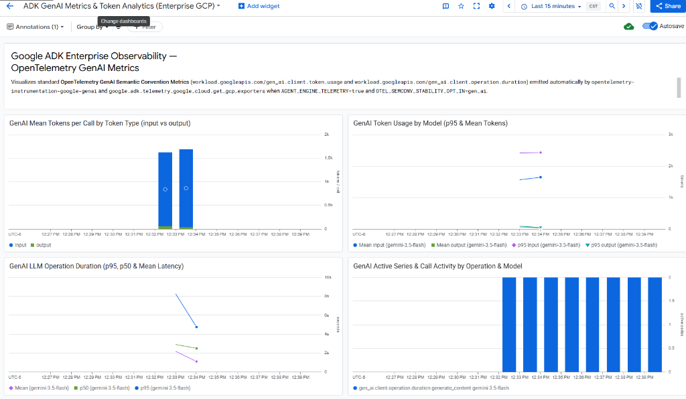
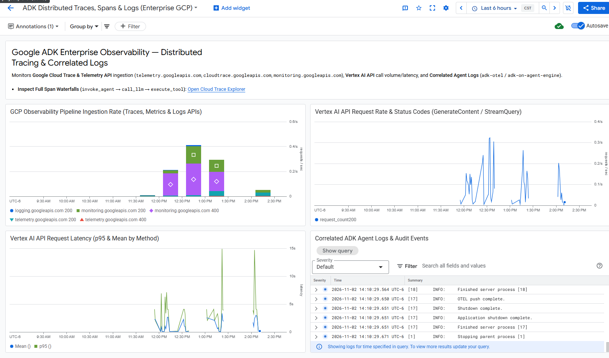

# Enterprise Edition: GCP Deployment & Observability Architecture

This guide covers deploying the **Google ADK `OpsAgent` (SRE Copilot)** and its **OpenTelemetry GenAI Observability Pipeline** to production **Google Cloud Platform (GCP)** environments.

We provide three production-ready reference architectures depending on your operational requirements:

| Architecture | Dedicated Guide | Best For | Telemetry Pipeline |
| :--- | :--- | :--- | :--- |
| **Option 1: Vertex AI Agent Engine (Reasoning Engine)** | **[`deploy/agent_engine/README.md`](./deploy/agent_engine/README.md)** | Turnkey managed ADK runtime with built-in session state, memory bank, and zero container management | Native `AdkApp` tracing + ADK `get_gcp_exporters()` (`telemetry.googleapis.com` -> Cloud Trace & Managed Prometheus) |
| **Option 2: Google Cloud Run + OTel Collector Sidecar** | **[`deploy/cloud_run/README.md`](./deploy/cloud_run/README.md)** | Serverless containers hosting the interactive ADK Web UI / FastAPI API + centralized PII prompt redaction | Multi-container Pod: ADK Agent (`:8000`) -> OTel Collector Sidecar (`:4318`) -> Cloud Trace & Managed Prometheus (GMP) |
| **Option 3: Dynatrace + GCP Secret Manager** | **[`deploy/dynatrace/README.md`](./deploy/dynatrace/README.md)** | Enterprise Dynatrace SaaS/Grail observability with credentials resolved dynamically from GCP Secret Manager | Runtime Secret Manager fetch (`dynatrace-env-url` & `dynatrace-api-token`) -> Dynatrace OTLP (`/api/v2/otlp`) |

---

## Architecture Comparison

```mermaid
flowchart TB
    subgraph Opt1["Option 1: Vertex AI Agent Engine (Managed ADK Runtime)"]
        direction LR
        User1["Client / Slack / API"] -->|IAM Auth| AE["Vertex AI Agent Engine\n(AdkApp: OpsAgent)"]
        AE -->|Direct GCP OTel SDK| GCP1["Cloud Trace\nCloud Monitoring (GMP)\nCloud Logging"]
    end

    subgraph Opt2["Option 2: Google Cloud Run (Multi-Container Sidecar)"]
        direction LR
        User2["Browser / API via IAP"] -->|HTTPS :8000| CR_Main["Container 1: ADK Agent\n(FastAPI / ADK Web)"]
        CR_Main -->|OTLP HTTP localhost:4318| CR_Sidecar["Container 2: Google-Built\nOTel Collector Sidecar"]
        CR_Sidecar -->|PII Redacted Telemetry| GCP2["Cloud Trace\nManaged Prometheus (GMP)\nCloud Logging -> BigQuery"]
    end
```



---

## Required GCP APIs (Both Options)

Before deploying either architecture, enable the core Google Cloud APIs in your target project:

```bash
export PROJECT_ID="your-gcp-project-id"
export REGION="us-central1"

gcloud config set project "${PROJECT_ID}"

# Enable core Vertex AI, Observability, and Security APIs
gcloud services enable \
  aiplatform.googleapis.com \
  telemetry.googleapis.com \
  cloudtrace.googleapis.com \
  monitoring.googleapis.com \
  logging.googleapis.com \
  secretmanager.googleapis.com \
  iam.googleapis.com \
  cloudresourcemanager.googleapis.com
```

### Additional APIs per Option

| Option | Additional Required APIs | Enable Command |
| :--- | :--- | :--- |
| **Option 1: Vertex AI Agent Engine** | Cloud Storage API (for staging wheel/agent artifacts) | `gcloud services enable storage.googleapis.com` |
| **Option 2: Google Cloud Run + Sidecar** | Cloud Run API, Artifact Registry API, Cloud Build API, IAP API | `gcloud services enable run.googleapis.com artifactregistry.googleapis.com cloudbuild.googleapis.com iap.googleapis.com` |

---

## Least-Privilege IAM Roles

Both options replace static `.env` Gemini API keys with **Workload Identity / Dedicated Service Accounts**:

| IAM Role | Role ID | Purpose |
| :--- | :--- | :--- |
| **Vertex AI User** | `roles/aiplatform.user` | Invoke `gemini-2.5-flash` / `gemini-2.5-pro` via Vertex AI and run Agent Engine sessions |
| **Cloud Trace Agent** | `roles/cloudtrace.agent` | Write OpenTelemetry distributed trace spans (`invoke_agent`, `call_llm`, `execute_tool`) |
| **Monitoring Metric Writer** | `roles/monitoring.metricWriter` | Export `gen_ai.client.token.usage` and `gen_ai.client.operation.duration` histograms to GMP |
| **Logs Writer** | `roles/logging.logWriter` | Write structured JSON logs correlated with `logging.googleapis.com/trace` |
| **Secret Manager Secret Accessor** | `roles/secretmanager.secretAccessor` | *(Optional)* Retrieve third-party tool credentials at runtime |

---

## Deep-Dive Implementation Guides

Choose your deployment pattern below for full step-by-step instructions, configuration files, and verification commands:

1. **[Option 1: Deploy to Vertex AI Agent Engine (Reasoning Engine)](./deploy/agent_engine/README.md)**
   - Uses `vertexai.agent_engines.AdkApp` with `google-adk[otel]>=2.13.0`
   - Zero Dockerfiles or custom metric code required
   - Native OpenTelemetry integration via `google.adk.telemetry.google_cloud.get_gcp_exporters` (`https://telemetry.googleapis.com/v1/metrics`), automatically emitting all **7 `prometheus.googleapis.com/gen_ai.*/histogram` metrics** to Google Cloud Managed Service for Prometheus (GMP):
     - `prometheus.googleapis.com/gen_ai.client.operation.duration/histogram`
     - `prometheus.googleapis.com/gen_ai.client.token.usage/histogram`
     - `prometheus.googleapis.com/gen_ai.execute_tool.duration/histogram`
     - `prometheus.googleapis.com/gen_ai.invoke_agent.duration/histogram`
     - `prometheus.googleapis.com/gen_ai.invoke_agent.inference_calls/histogram`
     - `prometheus.googleapis.com/gen_ai.invoke_agent.tool_calls/histogram`
     - `prometheus.googleapis.com/gen_ai.invoke_workflow.duration/histogram`
   - Activated via standard environment variables:
     ```bash
     # Same telemetry settings the ADK team uses on Agent Engine
     GOOGLE_CLOUD_AGENT_ENGINE_ENABLE_TELEMETRY=true
     ADK_TELEMETRY_SCHEMA_VERSION_OPT_IN=1
     OTEL_SEMCONV_STABILITY_OPT_IN=gen_ai_latest_experimental
     OTEL_INSTRUMENTATION_GENAI_CAPTURE_MESSAGE_CONTENT=EVENT_ONLY
     ```
2. **[Option 2: Deploy to Google Cloud Run with OpenTelemetry Collector Sidecar](./deploy/cloud_run/README.md)**
   - Uses Cloud Run multi-container sidecar architecture
   - Runs `otelcol-google` sidecar with PII prompt redaction (`redaction` processor) and `sum` connector
   - Exports directly to Google Cloud Managed Service for Prometheus (GMP) and Cloud Trace
3. **[Option 3: Enterprise Observability with Dynatrace & GCP Secret Manager](./deploy/dynatrace/README.md)**
   - Stores Dynatrace Environment URL (`dynatrace-env-url`) and API Token (`dynatrace-api-token`) in Google Cloud Secret Manager
   - Resolves credentials dynamically at runtime when `DYNATRACE_ENABLED=true` (both locally and on Vertex AI Agent Engine)
   - Exports all **7 native `gen_ai.*` metrics** (`DELTA` temporality), distributed trace spans (`invoke_agent`, `call_llm`, `execute_tool`), and correlated logs to Dynatrace (`/api/v2/otlp`)
   - Provisions two separate Dynatrace dashboards via [`deploy/dynatrace/provision_dashboards.py`](./deploy/dynatrace/provision_dashboards.py):
     - [Google ADK — GenAI Metrics & Token Analytics (`5443daae-e753-49b5-94ed-32d48b707e23`)](https://voy39934.apps.dynatrace.com/ui/apps/dynatrace.classic.dashboards/#dashboard;id=5443daae-e753-49b5-94ed-32d48b707e23)
     - [Google ADK — Distributed Traces, Spans & Correlated Logs (`575caaa3-b37f-4489-8b24-218aa0ac0118`)](https://voy39934.apps.dynatrace.com/ui/apps/dynatrace.classic.dashboards/#dashboard;id=575caaa3-b37f-4489-8b24-218aa0ac0118)

---

## Live GCP Enterprise Observability Showcase (`adk-enterprise-observability`)

### 1. GCP Cloud Monitoring — GenAI Token Usage & Latency Dashboard
Provisioned via [`deploy/gcp_dashboards/adk-genai-gcp-dashboard.json`](./deploy/gcp_dashboards/adk-genai-gcp-dashboard.json):


### 2. GCP Cloud Trace Waterfall & Correlated Logs Dashboard
Provisioned via [`deploy/gcp_dashboards/adk-traces-gcp-dashboard.json`](./deploy/gcp_dashboards/adk-traces-gcp-dashboard.json):

