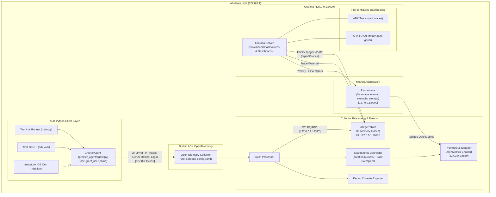

# Implementation Plan: `adk-otel` Local Observability Demo

A complete, runnable, Windows-first local observability stack for Google Agent Development Kit (ADK) Python agents, exporting full OpenTelemetry traces, GenAI metrics, and logs to a locally hosted telemetry stack (OpenTelemetry Collector, Jaeger, Prometheus with exemplars, and Grafana) without Docker, Kubernetes, or cloud dependencies.

---

## 1. System Architecture & Telemetry Data Flow



---

## 2. Directory Layout

```text
adk/
├── .env.example                       # Safe environment variable template (no credentials)
├── .gitignore                          # Ignores .env, venv, __pycache__, .adk, logs
├── requirements.txt                    # Python dependencies with compatible version constraints
├── otel-collector-config.yaml          # OpenTelemetry Collector routing & connector setup
├── prometheus/
│   └── prometheus.yml                  # 5s scrape config pointing to Collector :8889
├── grafana/
│   ├── provisioning/
│   │   ├── datasources/
│   │   │   └── datasources.yaml        # Prometheus, Jaeger, Infinity (jaeger-api) configs
│   │   └── dashboards/
│   │       └── dashboards.yaml         # File provider pointing to dashboards folder
│   └── dashboards/
│       ├── adk-genai.json              # ADK GenAI Metrics dashboard (UID: adk-genai)
│       └── adk-traces.json             # ADK Traces & Waterfall dashboard (UID: adk-traces)
├── greeter_agent/
│   ├── __init__.py                     # Injects OS truststore before model client initialization
│   └── agent.py                        # GreeterAgent, greet_user tool, model resolution logic
├── main.py                             # Interactive CLI runner with explicit OTel lifecycle
├── scripts/
│   ├── start-stack.ps1                 # Orchestrates dependency startup, port checks, flags
│   └── tail-metrics.ps1                # Streams and formats live GenAI metrics from logs
├── tests/
│   └── test_agent.py                   # Offline verification (tool, model resolution, agent build)
└── README.md                           # Complete documentation, setup, architecture, and run guide
```

---

## 3. Detailed Component Specifications

### 3.1. Agent Implementation (`greeter_agent/`)
- **`greeter_agent/__init__.py`**:
  - Injects Windows certificate store via `truststore.inject_into_ssl()` before any HTTP/gRPC or model clients are loaded.
  - Ensures seamless operation behind corporate SSL-inspecting proxies without disabling certificate verification.
  - **Crucial for GitHub Copilot & Cloud APIs**: When authenticating with GitHub Copilot (via device code flow to `github.com`) or calling cloud APIs (Google Gemini, OpenAI, Anthropic) over corporate networks, intercepting proxies re-sign traffic with private enterprise Root CAs. `truststore` allows Python to validate these certificates against the Windows system store automatically.
- **`greeter_agent/agent.py`**:
  - **Tool `greet_user(name: str) -> dict`**:
    - Pure, side-effect-free tool returning `{"status": "success", "greeting": f"Hello, {name}! Welcome to the ADK Observability demo."}`.
    - No credential or authentication flow inside the tool.
  - **Multi-Provider Model Resolution**:
    - Inspects `os.environ.get("ADK_MODEL", "gemini-2.5-flash")`.
    - **Google GenAI Native**: If `ADK_MODEL.startswith("gemini-")`, passes model string directly to ADK's native Google GenAI integration (authenticated via `GOOGLE_API_KEY` or Vertex AI credentials).
    - **LiteLLM Multi-Provider**: For any other model prefix, uses `google.adk.models.lite_llm.LiteLlm(model_name=ADK_MODEL)`:
      - **GitHub Copilot**: `github_copilot/gpt-4.1` or `github_copilot/gpt-4o` (one-time interactive device sign-in via terminal; tokens cached safely in user profile).
      - **Ollama (Local)**: `ollama_chat/llama3.2` or `ollama_chat/mistral` (configured via `OLLAMA_API_BASE`).
      - **OpenAI**: `openai/gpt-4o-mini` or `openai/gpt-4o` (reads `OPENAI_API_KEY`).
      - **Anthropic**: `anthropic/claude-3-5-sonnet-20241022` (reads `ANTHROPIC_API_KEY`).
      - **Groq**: `groq/llama-3.3-70b-versatile` (reads `GROQ_API_KEY`).
  - **Instruction Prompt**:
    - Friendly, concise greeter.
    - Uses `greet_user` when the user explicitly provides their name.
    - Answers other questions directly and strictly limits responses to under three sentences.
  - **Exports**:
    - Exposes `agent = root_agent = GreeterAgent` for automatic detection by both `main.py` and `adk web`.

### 3.2. Terminal Runner (`main.py`)
- Loads environment variables from `.env` via `python-dotenv`.
- Explicitly initializes ADK OpenTelemetry via `google.adk.telemetry.setup.maybe_set_otel_providers()`.
- Creates an `InMemorySessionService` and an ADK `Runner`.
- Provides an interactive REPL reading from `stdin`:
  - Skips empty/blank lines.
  - Handles exit commands (`exit`, `quit`, `/q`) and interrupts (`Ctrl+C`, `EOF`).
  - Submits user input to the agent session and prints final agent text output cleanly.
- Implements an explicit shutdown handler (`atexit` / `try...finally`):
  - Flushes and shuts down `trace.get_tracer_provider()` and `metrics.get_meter_provider()` to ensure buffered spans and metrics are delivered before the process terminates.

### 3.3. Collector & Telemetry Configuration (`otel-collector-config.yaml`)
- **Receivers**:
  - `otlp`: protocols `grpc` (`127.0.0.1:4317`) and `http` (`127.0.0.1:4318`).
- **Processors**:
  - `batch`: standard timeout/batch size parameters for responsive local delivery.
- **Connectors**:
  - `spanmetrics`: derives call counts and duration histograms from spans.
  - Duration histogram explicit buckets: `[0.002, 0.005, 0.01, 0.025, 0.05, 0.1, 0.25, 0.5, 1.0, 2.5, 5.0, 10.0, 30.0, 80.0]`.
  - Enables trace-ID exemplars on histogram buckets.
- **Exporters**:
  - `otlp/jaeger`: forwards spans via gRPC to `127.0.0.1:14317` with `tls: insecure: true`.
  - `prometheus`: binds to `127.0.0.1:8889`, `enable_open_metrics: true`, `resource_to_telemetry_conversion: enabled: true`.
  - `debug`: verbosity `detailed` for console logging of traces, metrics, and logs.
- **Pipelines**:
  - `traces`: receivers `[otlp]` -> processors `[batch]` -> exporters `[otlp/jaeger, debug]`, connector `[spanmetrics]`.
  - `metrics`: receivers `[otlp, spanmetrics]` -> processors `[batch]` -> exporters `[prometheus, debug]`.
  - `logs`: receivers `[otlp]` -> processors `[batch]` -> exporters `[debug]`.

### 3.4. Prometheus Configuration (`prometheus/prometheus.yml`)
- Scrape configuration:
  - `scrape_interval: 5s`
  - Target: `127.0.0.1:8889`
- Exemplar storage enabled via startup flag `--enable-feature=exemplar-storage`.

### 3.5. Grafana Provisioning & Dashboards
- **Datasources (`grafana/provisioning/datasources/datasources.yaml`)**:
  - `prometheus`: UID `prometheus`, `isDefault: true`, URL `http://127.0.0.1:9090`, interval `5s`, exemplar trace link targeting Jaeger datasource.
  - `jaeger`: UID `jaeger`, URL `http://127.0.0.1:16686`, node graph enabled, trace ID timestamp lookup enabled.
  - `infinity`: UID `jaeger-api`, type `yesoreyeram-infinity-datasource`, allowed hosts restricted to `http://127.0.0.1:16686`. Direct bridge to Jaeger v2 `/api/v3/traces` for rich tabular trace queries.
- **Dashboard Provisioning (`grafana/provisioning/dashboards/dashboards.yaml`)**:
  - Standard provider referencing `grafana/dashboards/`.
- **Dashboards**:
  - **`adk-genai.json` (UID: `adk-genai`)**:
    - Refresh: `5s`, default range: `now-30m` to `now`.
    - Template variables: Service, Agent, Model, LLM Operation.
    - Stat panels: Total Invocations, Total LLM Calls, Tool Executions, Input Tokens, Output Tokens, LLM Error Rate.
    - KPI gauge/stat panels: Average Agent Latency, LLM p95 Latency, LLM Calls per Invocation, Tool Calls per Invocation.
    - Time-series charts:
      - Token Rate (`rate(gen_ai_client_token_usage_sum[1m])`) split by token type.
      - LLM Operation Duration (`histogram_quantile(0.95, sum(rate(gen_ai_client_operation_duration_seconds_bucket[5m])) by (le, operation))`).
      - Calls per minute by Model and Operation.
      - Tool Execution Rate and Duration (`gen_ai_execute_tool_*`).
      - Span Call Rate and Duration p95 with OpenMetrics exemplars rendered.
  - **`adk-traces.json` (UID: `adk-traces`)**:
    - Refresh: `10s`, default range: `now-1h` to `now`.
    - Infinity table query against Jaeger v2 `/api/v3/traces` extracting: Trace ID, Root Span, Start Time, Duration, Span Count, Error Count.
    - Interactive Trace Drilldown: Trace ID links into Grafana Jaeger Waterfall panel.
    - Span overview panels, error breakdowns, and cross-navigation link to `adk-genai` and standalone Jaeger UI (`http://127.0.0.1:16686`).

### 3.6. Windows Automation Scripts (`scripts/`)
- **`scripts/start-stack.ps1`**:
  - Sequential dependency startup:
    1. **Jaeger**: detects `jaeger.exe` (v2) or `jaeger-all-in-one.exe` (v1) via PATH or `JAEGER_BIN`. Starts with OTLP gRPC port `14317` and UI `16686`. Waits for `:16686`.
    2. **OpenTelemetry Collector**: starts `otelcol.exe` with `--config=otel-collector-config.yaml`. Waits for `:4318`.
    3. **Prometheus**: locates `prometheus.exe` (bypassing package manager shims if needed), launches with `--config.file=prometheus/prometheus.yml --web.listen-address=127.0.0.1:9090 --enable-feature=exemplar-storage`. Waits for `:9090`.
    4. **Grafana**: verifies/installs Infinity plugin (`grafana-cli plugins install yesoreyeram-infinity-datasource`), enables Jaeger gRPC toggle, sets provisioning path, launches `grafana-server.exe`. Waits for `:3000`.
    5. **ADK Dev UI**: verifies `.env` exists, reads environment assignments, launches `adk web --host 127.0.0.1 --port 8000 .` with variables forwarded. Waits for `:8000`.
  - Checks if a port is already active before launching to prevent redundant instances.
  - Outputs a colored summary table of all local services upon completion.
- **`scripts/tail-metrics.ps1`**:
  - Optional PowerShell streaming utility to tail and parse JSONL Collector output or local logs, filtering on `gen_ai` metrics and displaying human-readable timestamps, counters, and attributes.

### 3.7. Configuration & Security (.env and Open-Source Readiness)
- **Multi-Provider `.env.example`**:
  - Organized with clear sections and safe placeholder values for immediate testing:
    ```bash
    # ==============================================================================
    # ADK Model Configuration
    # ==============================================================================
    # Examples:
    #   gemini-2.5-flash                      (Google GenAI Native)
    #   github_copilot/gpt-4.1                (GitHub Copilot via LiteLLM)
    #   ollama_chat/llama3.2                  (Local Ollama via LiteLLM)
    #   openai/gpt-4o-mini                    (OpenAI via LiteLLM)
    #   anthropic/claude-3-5-sonnet-20241022  (Anthropic via LiteLLM)
    #   groq/llama-3.3-70b-versatile          (Groq via LiteLLM)
    ADK_MODEL=gemini-2.5-flash

    # --- Provider 1: Google Gemini (AI Studio) ---
    GOOGLE_API_KEY=

    # --- Provider 2: Google Vertex AI (Optional Cloud Auth) ---
    GOOGLE_GENAI_USE_VERTEXAI=False
    GOOGLE_CLOUD_PROJECT=
    GOOGLE_CLOUD_LOCATION=us-central1

    # --- Provider 3: Ollama (Local LLM) ---
    OLLAMA_API_BASE=http://127.0.0.1:11434

    # --- Provider 4: OpenAI ---
    OPENAI_API_KEY=

    # --- Provider 5: Anthropic ---
    ANTHROPIC_API_KEY=

    # --- Provider 6: Groq ---
    GROQ_API_KEY=

    # --- Provider 7: GitHub Copilot ---
    # Trigger one-time terminal sign-in via: litellm --model github_copilot/gpt-4.1
    # Cached credentials are stored securely in ~/.litellm/

    # ==============================================================================
    # OpenTelemetry Local Pipeline Configuration
    # ==============================================================================
    OTEL_SERVICE_NAME=adk-greeter
    OTEL_EXPORTER_OTLP_ENDPOINT=http://127.0.0.1:4318
    OTEL_EXPORTER_OTLP_PROTOCOL=http/protobuf
    OTEL_SEMCONV_STABILITY_OPT_IN=gen_ai
    OTEL_INSTRUMENTATION_GENAI_CAPTURE_MESSAGE_CONTENT=events
    OTEL_METRIC_EXPORT_INTERVAL=5000
    ```
- **Open-Source & LinkedIn Showcase Readiness**:
  - **Zero Credential Leaks**: `.gitignore` strictly protects `.env`, virtualenvs, credentials, and telemetry scratch files.
  - **License**: MIT License included for open-source sharing.
  - **LinkedIn / GitHub Presentation**: High-quality README with badges, architecture flowcharts, local setup steps, and screenshot guides for the two Grafana dashboards (`adk-genai` and `adk-traces`).
- **Security Boundaries**:
  - All hosted endpoints strictly bind to `127.0.0.1`.
  - Prompt/response content excluded from span attributes (event-only).
  - Explicit documentation explaining Jaeger in-memory data retention and Grafana's default local credentials (`admin`/`admin`).

---

## 4. Execution & Verification Steps

| Step | Action | Verification |
|------|--------|--------------|
| **1** | Create project scaffolding & dependencies (`requirements.txt`, `.env.example`, `.gitignore`) | Validate syntax and environment consistency |
| **2** | Implement `greeter_agent/` (`__init__.py`, `agent.py`) | Run isolated Python test: verify tool executes without credentials |
| **3** | Implement terminal client (`main.py`) | Verify module compiles and handles exit cleanly |
| **4** | Create Collector & Prometheus configurations (`otel-collector-config.yaml`, `prometheus/prometheus.yml`) | Verify YAML parsing and correct loopback bindings |
| **5** | Provision Grafana datasources and dashboards (`adk-genai.json`, `adk-traces.json`) | Verify JSON validity, datasource UID references, and PromQL metrics |
| **6** | Implement PowerShell launcher and helper scripts (`scripts/start-stack.ps1`, `scripts/tail-metrics.ps1`) | Run static PowerShell syntax analysis |
| **7** | Author comprehensive `README.md` | Ensure paths, ports, model options, and diagrams match implementation |
| **8** | Run offline acceptance checks | Execute non-network test suite and report results |
