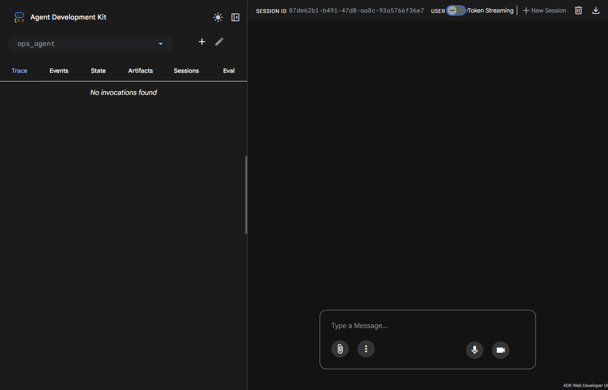
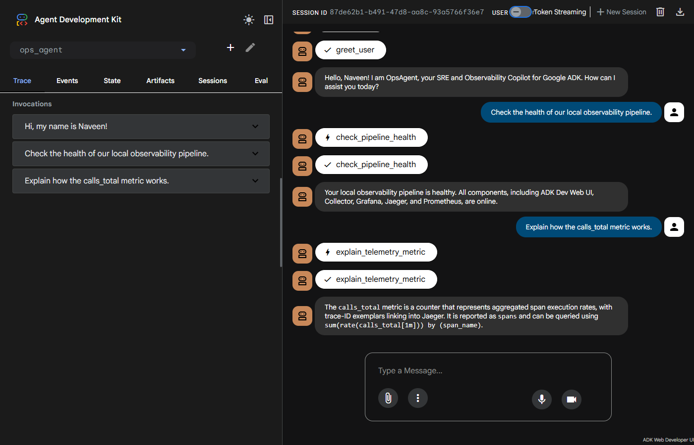
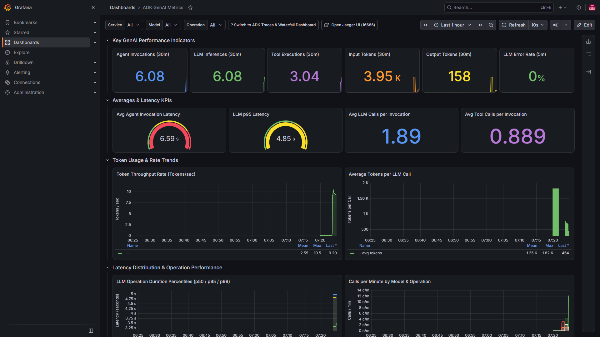
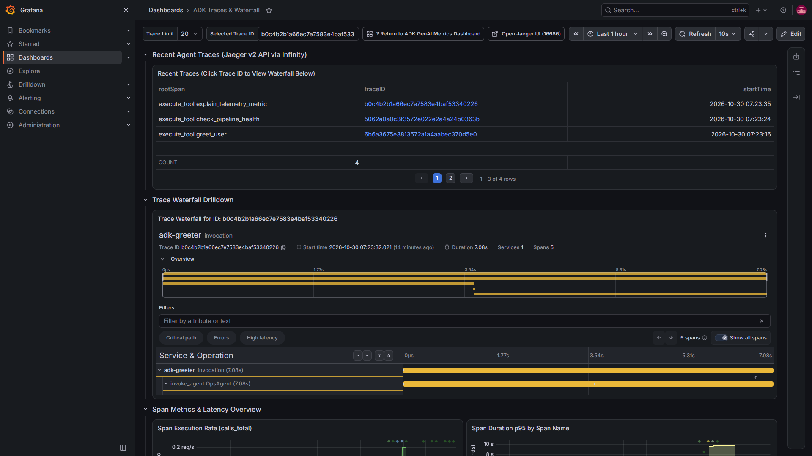
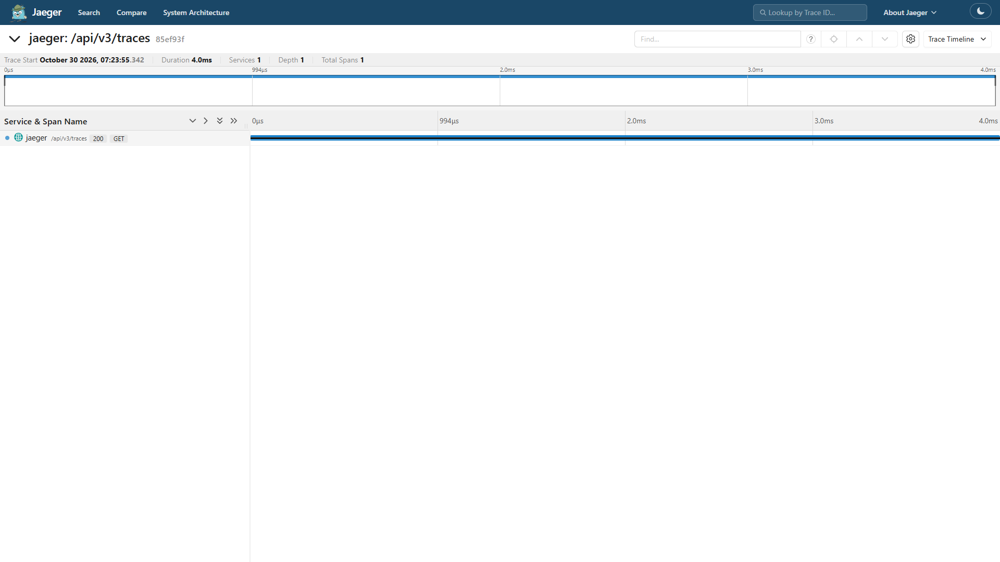
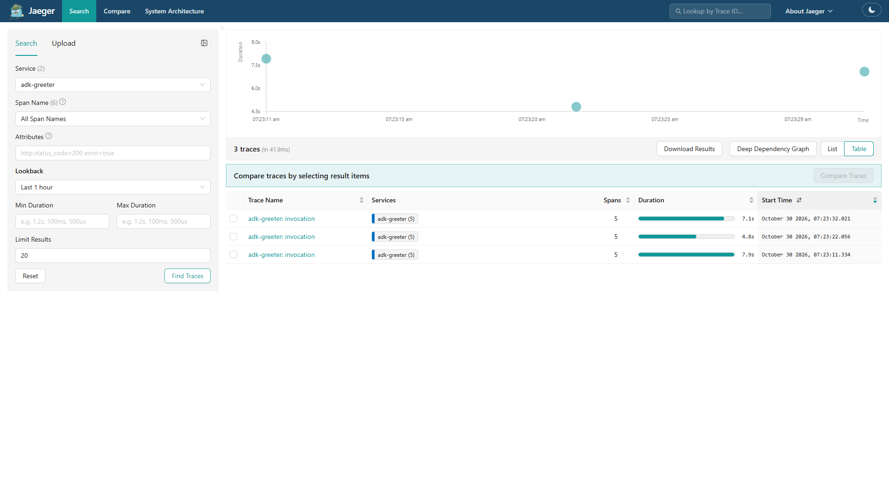
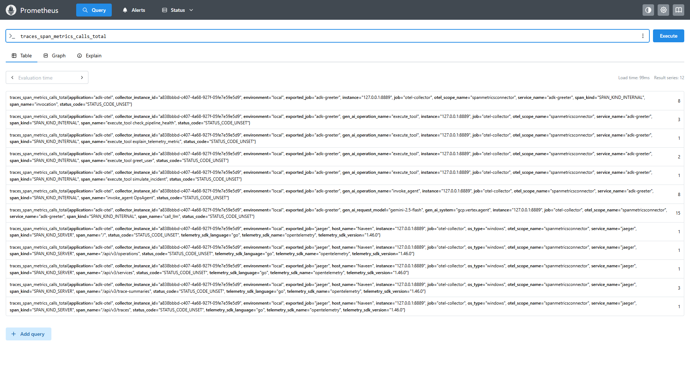

# 📸 ADK Observability Gallery & Live Walkthrough

This document showcases the local observability pipeline for **Google ADK Python Agents (`adk-otel`)**, featuring live snapshots of **Grafana dashboards**, **Jaeger trace waterfalls**, **Prometheus OpenMetrics**, and an animated walkthrough of the **ADK Dev Web UI**.

---

## 🎬 1. ADK Dev Web UI Walkthrough (Prompts & Responses)

The **ADK Dev UI** provides an interactive web workspace to converse with `OpsAgent` while observing real-time tool executions and telemetry generation.

### Live Chat Demo (Animated)


> 🎥 **Full High-Definition Video**: [Download or View `adk_web_demo.webm`](docs/media/adk_web_demo.webm)

### Executed Prompt & Response Sequence

| Step | User Prompt | Agent Action / Tool Invoked | Observed Telemetry Impact |
|:---|:---|:---|:---|
| **1** | *"Hi, my name is Naveen!"* | `greet_user(name="Naveen")` | Generates root span `invocation`, child span `invoke_agent OpsAgent`, and tool span `execute_tool greet_user`. Increments `calls_total`. |
| **2** | *"Check the health of our local observability pipeline."* | `check_pipeline_health()` | Probes loopback ports (4318, 4317, 8889, 9090, 3000, 16686, 8000). Reports health matrix directly in chat. |
| **3** | *"Explain how the calls_total metric works."* | `explain_telemetry_metric(metric_topic="spans")` | Returns definitions, Prometheus metric types, and sample PromQL queries (`sum(rate(calls_total[1m])) by (span_name)`). |

### Chat Interface Snapshot


---

## 📊 2. Grafana Dashboards

Grafana automatically provisions two dedicated dashboards connected to local Prometheus and Jaeger datasources.

### A. ADK GenAI Metrics Dashboard (`adk-genai`)
**Direct URL**: [http://127.0.0.1:3000/d/adk-genai](http://127.0.0.1:3000/d/adk-genai)



#### Panel Highlights:
- **Top KPI Stat Cards**:
  - **Agent Invocations (30m)**: Running count of completed user turns.
  - **LLM Calls (30m)**: Total inference requests sent to `gemini-2.5-flash`.
  - **Tool Executions (30m)**: Tool calls dispatched (e.g. `check_pipeline_health`, `explain_telemetry_metric`).
  - **Input & Output Tokens (30m)**: Accumulated token volume calculated via OpenTelemetry Collector `sum` connector.
  - **Error Rate (%)**: Percentage of failed operations (guaranteed 0% in healthy state).
- **Latency & Throughput Trends**:
  - **Average Agent Latency**: Real-time gauge tracking end-to-end response times in seconds.
  - **p95 LLM Duration**: 95th-percentile inference latency histogram.
  - **Token Throughput Rate (Tokens/sec)**: Input and output token velocity over time.
  - **Average Tokens per LLM Call**: Context window consumption per inference request.
- **Span Execution Rates & Duration Histograms**:
  - Categorized breakdown by span name (`call_llm`, `execute_tool`, `invoke_agent`). Clickable trace exemplars directly link into Jaeger.

---

### B. ADK Traces & Waterfall Dashboard (`adk-traces`)
**Direct URL**: [http://127.0.0.1:3000/d/adk-traces](http://127.0.0.1:3000/d/adk-traces)



#### Panel Highlights:
- **Recent Agent Traces Table**:
  - Live query against Jaeger v2 OTLP API (`/api/v3/traces`) using the Grafana Infinity datasource.
  - Extracts clean columns: `traceID`, `rootSpan`, and nanosecond-resolution `startTime`.
  - Clicking any `traceID` immediately updates the waterfall below.
- **Trace Waterfall Drilldown**:
  - Native Grafana Traces panel displaying the hierarchy and execution timeline across all spans for the selected trace ID.
- **Span Call Rate & Latency Overview**:
  - Prometheus time-series charts displaying span frequency and duration percentiles.

---

## 🔍 3. Jaeger Tracing Deep Dive

Jaeger captures distributed traces with nanosecond timing, tracking each prompt from entry to completion.

### A. Jaeger Trace Waterfall
**Direct URL**: `http://127.0.0.1:16686/trace/<trace-id>`



#### Span Hierarchy:
```text
invocation (Root Span)
└── invoke_agent OpsAgent
    ├── call_llm (Google GenAI Gemini-2.5-flash inference)
    ├── execute_tool check_pipeline_health (Python tool invocation)
    └── call_llm (Final synthesis)
```

### B. Jaeger Trace Search & Timeline
**Direct URL**: [http://127.0.0.1:16686/search?service=adk-greeter](http://127.0.0.1:16686/search?service=adk-greeter)



- Filters traces by service name (`adk-greeter`), operation name, time range, and duration tags.
- Provides a scatter plot distribution of trace duration over time.

---

## 📈 4. Prometheus Metrics & Exemplars

Prometheus scrapes OpenMetrics from the OpenTelemetry Collector on port `:8889` every 5 seconds.

**Direct URL**: [http://127.0.0.1:9090](http://127.0.0.1:9090)



#### Emitted & Scraped Metric Series:
- **`traces_span_metrics_calls_total`**: Counter of span executions categorized by `span_name` (`call_llm`, `execute_tool`, `invocation`, `invoke_agent`).
- **`traces_span_metrics_duration_milliseconds_bucket`**: Explicit-bucket latency histogram with trace-ID exemplars.
- **`traces_span_metrics_duration_milliseconds_count`** & **`sum`**: Cumulative latency counters for calculating rate-based averages.
- **Exemplar Storage**: Clickable trace IDs embedded inside OpenMetrics scrapes that bridge Prometheus metrics directly to Jaeger traces.

---

## 🛠️ How These Assets Were Generated

All snapshots and video recordings were generated automatically using [Playwright](https://playwright.dev/) running headless Google Chrome:

```powershell
# 1. Start the complete observability stack
.\scripts\start-stack.ps1

# 2. Record the interactive ADK Web session (video + GIF)
python scripts/record_adk_demo.py

# 3. Capture high-resolution snapshots of Prometheus, Jaeger, and Grafana
python scripts/capture_screenshots.py
```
