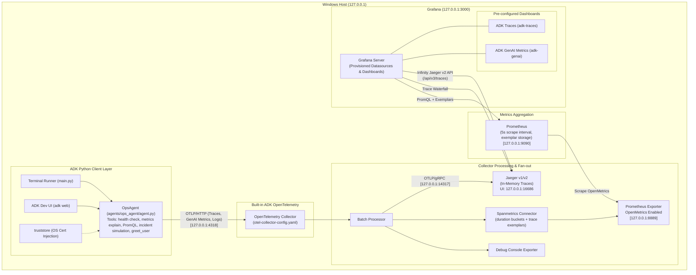

# adk-otel: Local Observability Demo for Google ADK Python Agents

[](https://opensource.org/licenses/MIT)
[](https://www.python.org/)
[](https://opentelemetry.io/)
[](https://google.github.io/adk-docs/)
[](https://microsoft.com/windows)

`google-adk` · `opentelemetry` · `grafana` · `prometheus` · `jaeger` · `genai-observability` · `python` · `llm-monitoring` · `sre-copilot`

A complete, Windows-first local observability stack for [Google Agent Development Kit (ADK)](https://google.github.io/adk-docs/) Python agents. Emits OpenTelemetry traces, GenAI metrics, and logs to a locally hosted observability stack without Docker, Kubernetes, or cloud dependencies.

> 📸 **Visual Showcase & Demo Video**: Check out [OBSERVABILITY_GALLERY.md](OBSERVABILITY_GALLERY.md) for live screenshots of Grafana dashboards, Jaeger waterfalls, Prometheus metrics, and an animated walkthrough of the ADK Dev Web UI with prompts and responses!

---

## 🏗️ Architecture & Telemetry Data Flow



---

## 📁 Project Layout

```text
adk-otel/
├── .env.example                       # Multi-provider template (Gemini, Copilot, Ollama, OpenAI, Claude, Groq)
├── .gitignore                          # Strict protection for .env, virtualenvs, caches, logs, .adk
├── LICENSE                             # MIT License
├── requirements.txt                    # Python dependencies with compatible constraints
├── otel-collector-config.yaml          # OpenTelemetry Collector routing & connector setup
├── prometheus/
│   └── prometheus.yml                  # 5s scrape config pointing to Collector :8889
├── grafana/
│   ├── provisioning/
│   │   ├── datasources/
│   │   │   └── datasources.yaml        # Prometheus, Jaeger, Infinity (jaeger-api) configs
│   │   └── dashboards/
│   │       └── dashboards.yaml         # File provider pointing to dashboards folder
│   └── dashboards/
│       ├── adk-genai.json              # ADK GenAI Metrics dashboard (UID: adk-genai)
│       └── adk-traces.json             # ADK Traces & Waterfall dashboard (UID: adk-traces)
├── agents/
│   └── ops_agent/                      # OpsAgent package for ADK Dev UI & CLI runner
│       ├── __init__.py                 # Injects OS truststore & initializes OTel providers
│       └── agent.py                    # OpsAgent (SRE Copilot), tools, multi-provider resolver
├── main.py                             # Interactive CLI runner with explicit OTel lifecycle
├── scripts/
│   ├── run-adk-web.ps1                 # Starts ADK Dev UI targeting agents/ (ops_agent only)
│   ├── run-grafana.ps1                 # Starts Grafana with Infinity plugin & provisioning
│   ├── start-stack.ps1                 # Orchestrates dependency startup, port checks, flags
│   ├── stop-stack.ps1                  # Cleanly shuts down all stack processes & frees ports
│   └── tail-metrics.ps1                # Streams and formats live GenAI metrics from logs
├── tests/
│   └── test_agent.py                   # Offline verification (tool, model resolution, agent build)
└── README.md                           # Documentation, setup, architecture, and run guide
```

---

## ⚡ Prerequisites

1. **Windows 10 / 11** with PowerShell 5.1+ or PowerShell 7+.
2. **Python 3.12+** (tested on 3.13 and 3.14).
3. **Observability Binaries** (available in your PATH or installed via [Scoop](https://scoop.sh/) or [Chocolatey](https://chocolatey.org/)):
   - **Jaeger**: `jaeger.exe` (v2) or `jaeger-all-in-one.exe` (v1)
     ```powershell
     scoop install jaeger
     ```
   - **OpenTelemetry Collector**: `otelcol.exe` or `otelcol-contrib.exe`
     ```powershell
     scoop install otelcol-contrib
     ```
   - **Prometheus**: `prometheus.exe`
     ```powershell
     scoop install prometheus
     ```
   - **Grafana**: `grafana-server.exe` and `grafana-cli.exe`
     ```powershell
     scoop install grafana
     ```

---

## 🚀 Quickstart

### 1. Clone & Set Up Python Environment

```powershell
git clone <your-repo-url> adk-otel
cd adk-otel

# Create virtual environment
python -m venv venv
.\venv\Scripts\Activate.ps1

# Install dependencies
pip install -r requirements.txt
```

### 2. Configure Environment

Copy `.env.example` to `.env`:
```powershell
Copy-Item .env.example .env
```

Edit `.env` to configure your preferred LLM provider:
- **Google Gemini (AI Studio)**: Set `GOOGLE_API_KEY=AIzaSy...` and `ADK_MODEL=gemini-2.5-flash`.
- **Local Ollama**: Set `ADK_MODEL=ollama_chat/llama3.2` (no API key needed; ensure Ollama is running).
- **GitHub Copilot**: Set `ADK_MODEL=github_copilot/gpt-4.1`.
- **OpenAI / Anthropic / Groq**: Set `ADK_MODEL=openai/gpt-4o-mini` and `OPENAI_API_KEY=...`.

### 3. Launch the Observability Stack

Launch all services in dependency order with one PowerShell command:
```powershell
.\scripts\start-stack.ps1
```

The script verifies each port and opens dedicated monitoring windows for:
1. **Jaeger**: `http://127.0.0.1:16686`
2. **OpenTelemetry Collector**: Receivers on `:4317` (gRPC) & `:4318` (HTTP), Prometheus exporter on `:8889`
3. **Prometheus**: `http://127.0.0.1:9090` (with `--enable-feature=exemplar-storage`)
4. **Grafana**: `http://127.0.0.1:3000` (Default login: `admin` / `admin`)
5. **ADK Dev UI**: `http://127.0.0.1:8000`

To stop all services and release all ports at any time:
```powershell
.\scripts\stop-stack.ps1
```

### 4. Chat with OpsAgent (SRE & Observability Copilot)

In an active PowerShell terminal:
```powershell
python main.py
```

Try asking:
- *"Hi, my name is Naveen!"* (triggers `greet_user`)
- *"Check the health of our local observability pipeline."* (triggers `check_pipeline_health`, probing ports 4318, 4317, 8889, 9090, 3000, 16686, 8000)
- *"Explain how the gen_ai.client.token.usage metric works."* (triggers `explain_telemetry_metric` with PromQL examples)
- *"Query the up metric in Prometheus."* (triggers `query_prometheus_metric` querying `http://127.0.0.1:9090`)
- *"Simulate a high-latency incident."* (triggers `simulate_incident`, introducing a real 500ms delay visible in Jaeger traces and Grafana p95 histograms)
- *"quit"* (flushes spans and metrics before exiting cleanly)

---

## 📊 Grafana Dashboards

Grafana automatically provisions two production-grade dashboards:

### 1. ADK GenAI Metrics (`adk-genai`)
- **Direct URL**: [http://127.0.0.1:3000/d/adk-genai](http://127.0.0.1:3000/d/adk-genai)
- **KPI Metrics**: Agent Invocations, LLM Calls, Tool Executions, Input Tokens, Output Tokens, Error Rate.
- **Latency & Throughput**: Average agent latency gauge, p95 LLM duration, token throughput (tokens/sec), and tokens per call.
- **Spanmetrics & Exemplars**: Span call rate and p95 duration with Prometheus OpenMetrics trace-ID exemplars rendered as clickable dots that link directly to Jaeger waterfalls.

### 2. ADK Traces & Waterfall (`adk-traces`)
- **Direct URL**: [http://127.0.0.1:3000/d/adk-traces](http://127.0.0.1:3000/d/adk-traces)
- **Recent Traces Table**: Queries Jaeger v2 `/api/v3/traces` via the Infinity plugin. Displays Trace ID, Root Span, Duration, and Error status.
- **Interactive Waterfall**: Clicking any Trace ID loads the full span waterfall in Grafana's native trace viewer.
- **Cross-Dashboard Navigation**: Direct link back to the GenAI metrics dashboard.

---

## 🔒 Security & Local Isolation

- **127.0.0.1 Loopback Only**: All services (ADK Dev UI, Collector, Jaeger, Prometheus, Grafana) bind strictly to `127.0.0.1`. No endpoints are exposed to the local network.
- **Event-Only Prompt Capture**: `OTEL_INSTRUMENTATION_GENAI_CAPTURE_MESSAGE_CONTENT=events` keeps sensitive prompt/response bodies out of span attributes. Spans capture operational metadata, tokens, and duration only.
- **Credential Protection**: `.gitignore` strictly excludes `.env`, `*.pem`, `*.key`, virtual environments, and `.adk/` state. Safe templates only exist in `.env.example`.
- **Ephemeral Jaeger Storage**: Jaeger runs in-memory. Traces reset when Jaeger restarts.
- **Grafana Credentials**: Local default login is `admin` / `admin`. You will be prompted to set a new password on first login.

---

## 🏢 Why We Use `truststore` (Windows & Corporate Networks)

Standard Python on Windows does not use the operating system's native Certificate Store (`CertMgr.msc` / `CertLM.msc`). Instead, Python relies on a hardcoded static Mozilla certificate bundle shipped with the `certifi` package.

### The Problem in Enterprise Environments
In corporate environments with deep packet inspection or TLS proxy gateways (e.g., **Zscaler, Netskope, Palo Alto Networks, Cisco Umbrella, BlueCoat**), all outbound HTTPS traffic is re-signed dynamically using an internal enterprise Root Certificate Authority (CA).
- Corporate IT distributes this Root CA to all Windows machines via **Active Directory Group Policy (GPO)** or **Microsoft Intune**.
- Edge, Chrome, and Windows tools trust this Root CA natively.
- Standard Python ignores the Windows certificate store, causing calls to Google Gemini APIs (`generativelanguage.googleapis.com`) or HTTPS endpoints to fail with:
  ```text
  ssl.SSLCertVerificationError: [SSL: CERTIFICATE_VERIFY_FAILED] certificate verify failed: self-signed certificate in certificate chain (_ssl.c:1018)
  ```

### How `truststore` Solves This
Before any network calls or SDKs are imported, `agents/ops_agent/__init__.py` executes:
```python
import truststore
truststore.inject_into_ssl()
```

1. **Native OS Integration**: `truststore` seamlessly monkey-patches Python's standard `ssl` module to verify certificates using Windows CryptoAPI (`Schannel`) rather than static `certifi` bundles.
2. **Zero Security Compromise**: Developers are never forced to disable SSL verification (`verify=False`), which introduces severe security vulnerabilities.
3. **Zero Configuration Overhead**: You don't need to manually locate, export, or convert enterprise `.crt` or `.pem` files, nor do you need to configure brittle environment variables like `REQUESTS_CA_BUNDLE` or `SSL_CERT_FILE`.
4. **Works Out-of-the-Box**: Outbound calls to Google GenAI APIs, Vertex AI endpoints, and local OTLP pipelines work immediately on managed enterprise laptops.

---

## 🤖 Python LiteLLM Package: Are We Using It and Why?

### Are We Actively Using `litellm`?
**No.** When running with Google Gemini (the default configuration `ADK_MODEL=gemini-2.5-flash`), **LiteLLM is completely bypassed**.

Google ADK communicates directly with Google's APIs using the official, high-performance `google-genai` native SDK. All LLM calls, token counters, function tool calls, and trace spans are generated directly by ADK's native Gemini client.

### Why is `litellm` Included in the Repository?

`litellm` is included as an **optional multi-provider abstraction layer** for local experimentation and multi-model benchmarking:

1. **ADK Multi-Model Adapter**: Google ADK provides a built-in wrapper (`google.adk.models.lite_llm.LiteLlm`) allowing agents to interface with over 100+ LLM backends through a unified interface.
2. **Dynamic Model Resolution (`resolve_model`)**: In [`agents/ops_agent/agent.py`](file:///agents/ops_agent/agent.py), the `resolve_model()` helper automatically detects the model prefix:
   - **`gemini-*` (Default)**: Direct native Google GenAI SDK (zero LiteLLM overhead).
   - **`ollama_chat/*`**: Direct connection to local offline Ollama models (e.g. `ollama_chat/llama3.2`) for offline or air-gapped demo runs.
   - **`github_copilot/*`**: Direct connection using GitHub Copilot credentials for developers without a personal Gemini API key.
   - **`openai/*`, `anthropic/*`, `groq/*`**: Optional third-party providers for cross-model latency and observability comparisons.
3. **Graceful Fallback**: If `litellm` is not installed or uninstalled from the environment, `resolve_model()` logs a non-fatal warning and gracefully passes through the raw model string to ADK. If you only plan to use Google Gemini, `litellm` is entirely optional.

---

## 🔑 Authentication & Model Selection

### 1. Google Gemini (Google AI Studio - Native GenAI SDK)
```bash
ADK_MODEL=gemini-2.5-flash
GOOGLE_API_KEY=your-api-key-here
```
*Direct native integration via `google-genai`. No LiteLLM involved.*

### 2. Google Vertex AI (Google Cloud IAM - Native GenAI SDK)
```bash
ADK_MODEL=gemini-2.5-flash
GOOGLE_GENAI_USE_VERTEXAI=True
GOOGLE_CLOUD_PROJECT=your-gcp-project-id
GOOGLE_CLOUD_LOCATION=us-central1
```
*Direct native integration via Vertex AI SDK.*

### 3. Local Ollama (Offline / Private - via LiteLLM Adapter)
```bash
ADK_MODEL=ollama_chat/llama3.2
OLLAMA_API_BASE=http://127.0.0.1:11434
```
*Runs 100% locally on your machine without external API calls.*

### 4. GitHub Copilot (via LiteLLM Adapter)
```bash
ADK_MODEL=github_copilot/gpt-4.1
```
Perform a one-time device authentication from a clean terminal:
```powershell
litellm --model github_copilot/gpt-4.1
```
Follow the browser prompt to input the one-time code. Credentials are encrypted and cached in `~/.litellm/`.

---

## 🛠️ Verification & Offline Testing

Run the automated offline test suite (requires no API keys or live network services):

```powershell
pytest tests/test_agent.py
```

Validates:
- `greet_user` tool returns success and formatted greeting.
- GreeterAgent instantiates cleanly without making network calls.
- Multi-provider model resolution routes `gemini-*` and non-gemini models accurately.
- `otel-collector-config.yaml` and `prometheus/prometheus.yml` pass strict schema checks.
- Grafana dashboard JSON files parse and contain matching UIDs (`adk-genai` and `adk-traces`).

---

## ❓ Troubleshooting

| Issue | Cause | Fix |
|---|---|---|
| `Executable not found in PATH` | Jaeger, Collector, Prometheus, or Grafana not installed | Install via `scoop install jaeger otelcol-contrib prometheus grafana` or set `JAEGER_BIN`. |
| `Port 16686 or 3000 already in use` | Another dev server is running | Stop the existing service or let `start-stack.ps1` detect and reuse the active port. |
| `Grafana Infinity plugin missing` | First time running Grafana | `start-stack.ps1` attempts auto-install via `grafana-cli plugins install yesoreyeram-infinity-datasource`. Run it manually if needed. |
| `Grafana Jaeger Search empty in v2` | Jaeger v2 internal search API changes | Use the provisioned `adk-traces` dashboard which queries Jaeger v2 `/api/v3/traces` directly via the Infinity datasource. |

---

## 📜 License

This project is licensed under the [MIT License](file:///C:/Users/navee/ADK/LICENSE).
