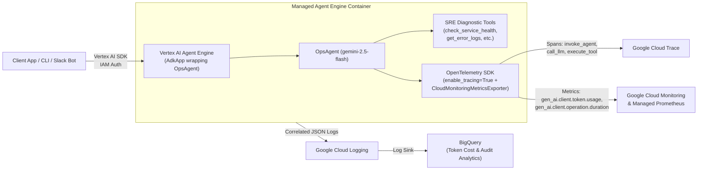

# Option 1: Deploying `OpsAgent` to Vertex AI Agent Engine (Reasoning Engine)

**Vertex AI Agent Engine** (formerly **Vertex AI Reasoning Engine**) is Google Cloud's fully managed runtime for **Google Agent Development Kit (ADK)** agents. It provides serverless execution, managed conversation session history (`VertexAiSessionService`), and built-in **Google Cloud Trace** integration without managing Docker containers or Kubernetes clusters.

---

## Architecture Overview



---

## 1. Required GCP APIs to Enable

Run the following `gcloud` commands to enable all APIs required for Vertex AI Agent Engine and its OpenTelemetry observability stack:

```bash
export PROJECT_ID="your-gcp-project-id"
export REGION="us-central1"
export STAGING_BUCKET="gs://${PROJECT_ID}-adk-staging"

gcloud config set project "${PROJECT_ID}"

gcloud services enable \
  aiplatform.googleapis.com \
  storage.googleapis.com \
  cloudtrace.googleapis.com \
  monitoring.googleapis.com \
  logging.googleapis.com \
  iam.googleapis.com \
  cloudresourcemanager.googleapis.com
```

### Why Each API is Required
| API | Service Name | Purpose |
| :--- | :--- | :--- |
| **Vertex AI API** | `aiplatform.googleapis.com` | Hosts the Reasoning Engine / Agent Engine runtime and provides access to `gemini-2.5-flash` |
| **Cloud Storage API** | `storage.googleapis.com` | Stages the serialized `AdkApp` bundle and local Python packages (`agents/`, `observability/`) |
| **Cloud Trace API** | `cloudtrace.googleapis.com` | Ingests OpenTelemetry distributed trace spans (`invoke_agent`, `call_llm`, `execute_tool`) |
| **Cloud Monitoring API** | `monitoring.googleapis.com` | Ingests `gen_ai.client.token.usage` and `gen_ai.client.operation.duration` metrics |
| **Cloud Logging API** | `logging.googleapis.com` | Collects structured agent logs correlated with Cloud Trace span IDs |

---

## 2. Create Staging Bucket & Configure IAM Permissions

### 2.1 Create the GCS Staging Bucket
Vertex AI Agent Engine requires a Regional Cloud Storage bucket in the same region (`us-central1`) to upload your agent code during deployment:

```bash
gcloud storage buckets create "${STAGING_BUCKET}" \
  --project="${PROJECT_ID}" \
  --location="${REGION}" \
  --uniform-bucket-level-access
```

### 2.2 Grant Telemetry & Vertex AI Permissions to the Reasoning Engine Service Agent
By default, Vertex AI Reasoning Engine executes under the **AI Platform Reasoning Engine Service Agent** (`service-<PROJECT_NUMBER>@gcp-sa-aiplatform-re.iam.gserviceaccount.com`) or a custom Service Account you specify:

```bash
PROJECT_NUMBER=$(gcloud projects describe "${PROJECT_ID}" --format="value(projectNumber)")
RE_SA="service-${PROJECT_NUMBER}@gcp-sa-aiplatform-re.iam.gserviceaccount.com"

# Grant permissions to invoke Gemini models, write traces, metrics, and logs
for ROLE in \
  roles/aiplatform.user \
  roles/cloudtrace.agent \
  roles/monitoring.metricWriter \
  roles/logging.logWriter; do
  gcloud projects add-iam-policy-binding "${PROJECT_ID}" \
    --member="serviceAccount:${RE_SA}" \
    --role="${ROLE}"
done
```

---

## 3. Step-by-Step Implementation

### Step 3.1: Install Vertex AI Agent Engine & GCP OpenTelemetry Dependencies
In your virtual environment, install the Vertex AI Agent Engine extras and Google Cloud OpenTelemetry exporters:

```bash
pip install \
  "google-cloud-aiplatform[adk,agent_engines]>=1.88.0" \
  "opentelemetry-exporter-gcp-trace>=1.7.0" \
  "opentelemetry-exporter-gcp-monitoring>=1.7.0" \
  "opentelemetry-resourcedetector-gcp>=1.7.0"
```

### Step 3.2: Configure Native GCP Exporters in `observability/otel_setup.py`
When running inside Vertex AI Agent Engine (where there is no local `127.0.0.1:4318` OTel Collector sidecar), add a `gcp` exporter mode to `observability/otel_setup.py`:

```python
import os
from opentelemetry import trace, metrics
from opentelemetry.sdk.trace import TracerProvider
from opentelemetry.sdk.trace.export import BatchSpanProcessor
from opentelemetry.sdk.metrics import MeterProvider
from opentelemetry.sdk.metrics.export import PeriodicExportingMetricReader

def setup_gcp_native_telemetry() -> None:
    """Export traces and metrics directly to Google Cloud Trace & Cloud Monitoring."""
    from opentelemetry.exporter.cloud_trace import CloudTraceSpanExporter
    from opentelemetry.exporter.cloud_monitoring import CloudMonitoringMetricsExporter
    from opentelemetry.resourcedetector.gcp_resource_detector import GoogleCloudResourceDetector

    resource = GoogleCloudResourceDetector().detect()

    # 1. Cloud Trace Exporter
    tracer_provider = TracerProvider(resource=resource)
    tracer_provider.add_span_processor(BatchSpanProcessor(CloudTraceSpanExporter()))
    trace.set_tracer_provider(tracer_provider)

    # 2. Cloud Monitoring Metrics Exporter
    metric_reader = PeriodicExportingMetricReader(
        CloudMonitoringMetricsExporter(),
        export_interval_millis=15000,
    )
    meter_provider = MeterProvider(resource=resource, metric_readers=[metric_reader])
    metrics.set_meter_provider(meter_provider)
```

### Step 3.3: Create the Deployment Script (`deploy/agent_engine/deploy.py`)
Create a deployment script that wraps `root_agent` from `agents.ops_agent.agent` inside `reasoning_engines.AdkApp` with `enable_tracing=True`:

```python
import os
import vertexai
from vertexai.preview import reasoning_engines
from agents.ops_agent.agent import root_agent

PROJECT_ID = os.environ["GOOGLE_CLOUD_PROJECT"]
LOCATION = os.environ.get("GOOGLE_CLOUD_LOCATION", "us-central1")
STAGING_BUCKET = os.environ["STAGING_BUCKET"]  # e.g., gs://my-project-adk-staging

# 1. Initialize Vertex AI SDK
vertexai.init(
    project=PROJECT_ID,
    location=LOCATION,
    staging_bucket=STAGING_BUCKET,
)

# 2. Wrap OpsAgent in AdkApp with native OpenTelemetry Cloud Trace enabled
adk_app = reasoning_engines.AdkApp(
    agent=root_agent,
    enable_tracing=True,
)

# 3. Test locally before cloud deployment
print("--- Running Local Pre-Deployment Smoke Test ---")
session = adk_app.create_session(user_id="sre-smoke-test")
for event in adk_app.stream_query(
    user_id="sre-smoke-test",
    session_id=session.id,
    message="Check the health status of payment-service and summarize.",
):
    print(event)

# 4. Deploy to Vertex AI Agent Engine
print("--- Deploying OpsAgent to Vertex AI Agent Engine ---")
remote_agent = reasoning_engines.ReasoningEngine.create(
    adk_app,
    requirements=[
        "google-adk>=1.0.0",
        "google-cloud-aiplatform[adk,agent_engines]>=1.88.0",
        "opentelemetry-sdk>=1.28.0",
        "opentelemetry-exporter-gcp-trace>=1.7.0",
        "opentelemetry-exporter-gcp-monitoring>=1.7.0",
    ],
    extra_packages=[
        "./agents",
        "./observability",
    ],
    env_vars={
        "GOOGLE_GENAI_USE_VERTEXAI": "True",
        "ADK_MODEL": "gemini-2.5-flash",
        "OTEL_SERVICE_NAME": "adk-ops-agent",
        "OTEL_INSTRUMENTATION_GENAI_CAPTURE_MESSAGE_CONTENT": "true",
    },
    display_name="ops-agent-sre-copilot",
    description="Google ADK SRE Copilot with OpenTelemetry GenAI Observability",
)

print(f"Successfully deployed! Resource Name: {remote_agent.resource_name}")
```

### Step 3.4: Alternative One-Command ADK CLI Deployment
Google ADK also includes a built-in CLI command to deploy an agent folder directly to Vertex AI Agent Engine:

```bash
adk deploy agent_engine \
  --project="${PROJECT_ID}" \
  --region="${REGION}" \
  --staging_bucket="${STAGING_BUCKET}" \
  --display_name="ops-agent-sre-copilot" \
  --trace_to_cloud \
  ./agents/ops_agent
```

---

## 4. Querying the Deployed Agent & Viewing Telemetry

### 4.1 Invoke the Remote Agent via Python SDK
Once deployed, query your Reasoning Engine endpoint from any authenticated service:

```python
import vertexai
from vertexai.preview import reasoning_engines

vertexai.init(project="your-gcp-project-id", location="us-central1")

# Connect using the resource name output during deployment
remote_agent = reasoning_engines.ReasoningEngine(
    "projects/YOUR_PROJECT_NUMBER/locations/us-central1/reasoningEngines/YOUR_ENGINE_ID"
)

remote_session = remote_agent.create_session(user_id="oncall-engineer")
for event in remote_agent.stream_query(
    user_id="oncall-engineer",
    session_id=remote_session["id"],
    message="Investigate why payment-service has high latency, check error logs, and create an incident ticket.",
):
    print(event)
```

### 4.2 Inspect Traces & Metrics in Google Cloud Console
1. **Cloud Trace Waterfall**:
   - Open **Google Cloud Console → Trace → Trace Explorer**.
   - Filter by Span Name `invoke_agent`, `call_llm`, or `execute_tool`.
   - Click any trace to inspect the full waterfall (`OpsAgent` → `gemini-2.5-flash` → `check_service_health` → `get_error_logs` → `create_incident_ticket`) along with `gen_ai.usage.input_tokens` and `gen_ai.usage.output_tokens` attributes.
2. **Cloud Monitoring / Managed Prometheus (GMP)**:
   - Open **Cloud Monitoring → Metrics Explorer → PromQL**.
   - Query token consumption:
     ```promql
     sum by (gen_ai_token_type, gen_ai_request_model) (rate(gen_ai_client_token_usage_sum[5m]))
     ```

---

## 5. Clean Up (Avoid Ongoing Charges)

Vertex AI Agent Engine bills for active runtime instances. To delete a deployed Reasoning Engine instance when not in use:

```python
remote_agent.delete(force=True)
```
Or via `gcloud`:
```bash
gcloud ai reasoning-engines delete YOUR_ENGINE_ID --region="${REGION}" --project="${PROJECT_ID}"
```
