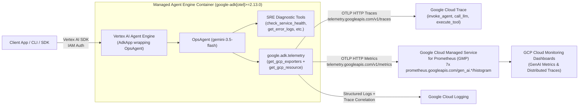
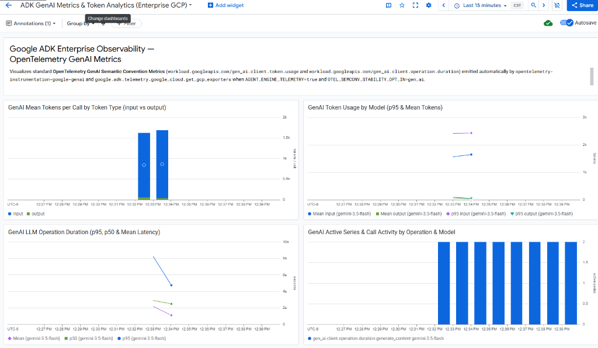
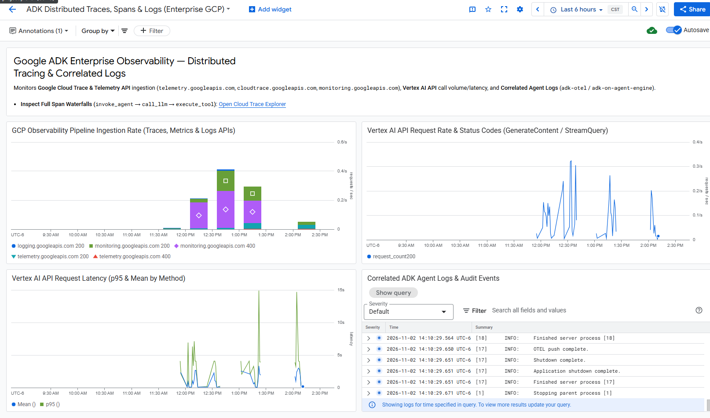

# Option 1: Deploying `OpsAgent` to Vertex AI Agent Engine (Reasoning Engine)

**Vertex AI Agent Engine** (formerly **Vertex AI Reasoning Engine**) is Google Cloud's fully managed runtime for **Google Agent Development Kit (ADK)** agents. With **`google-adk[otel]>=2.13.0`**, ADK natively exports distributed traces, correlated logs, and **all 7 OpenTelemetry GenAI histogram metrics (`prometheus.googleapis.com/gen_ai.*/histogram`)** to **Google Cloud Managed Service for Prometheus (GMP)** via the Google Cloud Telemetry API (`telemetry.googleapis.com`)—requiring **zero custom metric instrumentation code** in `agent.py`.

---

## Architecture Overview



---

## 1. Native ADK GenAI Prometheus Metrics (`prometheus.googleapis.com/gen_ai.*/histogram`)

When `GOOGLE_CLOUD_AGENT_ENGINE_ENABLE_TELEMETRY=true` is enabled in `google-adk[otel]>=2.13.0`, ADK's built-in `google.adk.telemetry` (`_metrics.py` + `opentelemetry-instrumentation-google-genai`) automatically emits all **7 GenAI histogram metrics** to Google Cloud Managed Service for Prometheus:

| # | Metric Type in Cloud Monitoring / GMP | Kind / Type | Key Metric Labels | Description |
| :- | :--- | :--- | :--- | :--- |
| **1** | `prometheus.googleapis.com/gen_ai.client.operation.duration/histogram` | `DISTRIBUTION` (`CUMULATIVE`) | `gen_ai.request.model`, `gen_ai.operation.name`, `gen_ai.system` | End-to-end LLM inference latency (`generate_content`) in seconds |
| **2** | `prometheus.googleapis.com/gen_ai.client.token.usage/histogram` | `DISTRIBUTION` (`CUMULATIVE`) | `gen_ai.token.type` (`input`, `output`), `gen_ai.request.model`, `gen_ai.operation.name` | Input and output token consumption per LLM call |
| **3** | `prometheus.googleapis.com/gen_ai.execute_tool.duration/histogram` | `DISTRIBUTION` (`CUMULATIVE`) | `gen_ai.tool.name`, `gen_ai.tool.type`, `gen_ai.agent.name` | Execution latency of each ADK tool (`check_service_health`, `get_error_logs`, etc.) |
| **4** | `prometheus.googleapis.com/gen_ai.invoke_agent.duration/histogram` | `DISTRIBUTION` (`CUMULATIVE`) | `gen_ai.agent.name` | Total duration of an agent invocation (`OpsAgent`) |
| **5** | `prometheus.googleapis.com/gen_ai.invoke_agent.inference_calls/histogram` | `DISTRIBUTION` (`CUMULATIVE`) | `gen_ai.agent.name` | Number of LLM inference calls made per agent invocation |
| **6** | `prometheus.googleapis.com/gen_ai.invoke_agent.tool_calls/histogram` | `DISTRIBUTION` (`CUMULATIVE`) | `gen_ai.agent.name` | Number of tool calls executed per agent invocation |
| **7** | `prometheus.googleapis.com/gen_ai.invoke_workflow.duration/histogram` | `DISTRIBUTION` (`CUMULATIVE`) | `gen_ai.workflow.name`, `gen_ai.operation.name` | Total workflow / entrypoint invocation duration |

---

## 2. Required GCP APIs to Enable

Run the following `gcloud` commands to enable all APIs required for Vertex AI Agent Engine and the Google Cloud Telemetry OTLP ingestion pipeline:

```bash
export PROJECT_ID="adk-enterprise-observability"
export REGION="us-central1"
export STAGING_BUCKET="gs://${PROJECT_ID}-staging"

gcloud config set project "${PROJECT_ID}"

gcloud services enable \
  aiplatform.googleapis.com \
  telemetry.googleapis.com \
  storage.googleapis.com \
  cloudtrace.googleapis.com \
  monitoring.googleapis.com \
  logging.googleapis.com \
  iam.googleapis.com \
  cloudresourcemanager.googleapis.com
```

### Why Each API is Required
| API | Service Name | Purpose |
| :--- | :--- | :--- |
| **Vertex AI API** | `aiplatform.googleapis.com` | Hosts the Vertex AI Agent Engine runtime and provides access to Gemini models |
| **Cloud Telemetry API** | `telemetry.googleapis.com` | OTLP HTTP ingestion endpoint (`https://telemetry.googleapis.com/v1/metrics` & `/v1/traces`) used by `google.adk.telemetry` to write `prometheus.googleapis.com/gen_ai.*/histogram` metrics |
| **Cloud Storage API** | `storage.googleapis.com` | Stages serialized `AdkApp` artifacts (`agent_engine.pkl`, `requirements.txt`, `dependencies.tar.gz`) |
| **Cloud Trace API** | `cloudtrace.googleapis.com` | Stores and queries distributed trace waterfalls (`invoke_agent`, `call_llm`, `execute_tool`) |
| **Cloud Monitoring API** | `monitoring.googleapis.com` | Queries GMP metrics (`prometheus.googleapis.com/gen_ai.*/histogram`) and hosts custom dashboards |
| **Cloud Logging API** | `logging.googleapis.com` | Collects structured agent logs and GenAI prompt/completion events correlated with Trace IDs |

---

## 3. Create Staging Bucket & Configure Least-Privilege IAM

### 3.1 Create the GCS Staging Bucket
```bash
gcloud storage buckets create "${STAGING_BUCKET}" \
  --project="${PROJECT_ID}" \
  --location="${REGION}" \
  --uniform-bucket-level-access
```

### 3.2 Configure Dedicated Service Account & IAM Roles
```bash
SA_NAME="adk-agent-engine-sa"
SA_EMAIL="${SA_NAME}@${PROJECT_ID}.iam.gserviceaccount.com"

gcloud iam service-accounts create "${SA_NAME}" \
  --display-name="ADK Vertex AI Agent Engine Service Account" \
  --project="${PROJECT_ID}"

# Grant permissions to invoke Gemini models and write OTLP traces, GMP metrics, and logs
for ROLE in \
  roles/aiplatform.user \
  roles/telemetry.writer \
  roles/cloudtrace.agent \
  roles/monitoring.metricWriter \
  roles/logging.logWriter \
  roles/storage.objectViewer; do
  gcloud projects add-iam-policy-binding "${PROJECT_ID}" \
    --member="serviceAccount:${SA_EMAIL}" \
    --role="${ROLE}"
done
```

---

## 4. Telemetry Configuration & Environment Variables

### 4.1 Install Dependencies (`google-adk[otel]>=2.13.0`)
```bash
pip install \
  "google-adk[otel]>=2.13.0" \
  "google-genai>=2.34.0" \
  "google-cloud-aiplatform[adk,agent_engines]>=2.7.0" \
  "opentelemetry-sdk>=1.39.0" \
  "opentelemetry-exporter-otlp-proto-http>=1.39.0" \
  "opentelemetry-instrumentation-google-genai>=0.7b0"
```

### 4.2 Standard Agent Engine Telemetry Environment Variables
Set the following environment variables in `.env` or in `deploy/agent_engine/deploy.py`:

```bash
# Same telemetry settings the ADK team uses on Agent Engine
GOOGLE_CLOUD_AGENT_ENGINE_ENABLE_TELEMETRY=true
ADK_TELEMETRY_SCHEMA_VERSION_OPT_IN=1
OTEL_SEMCONV_STABILITY_OPT_IN=gen_ai_latest_experimental
OTEL_INSTRUMENTATION_GENAI_CAPTURE_MESSAGE_CONTENT=EVENT_ONLY

# Required when exporting to telemetry.googleapis.com/v1/metrics outside Agent Engine
OTEL_RESOURCE_ATTRIBUTES=cloud.region=us-central1,gcp.project_id=adk-enterprise-observability
```

> **Important Notes:**
> 1. **`cloud.region` Resource Attribute**: `https://telemetry.googleapis.com/v1/metrics` requires `cloud.region` (e.g., `us-central1`) on the OpenTelemetry `Resource` to map OTLP histograms to a valid Google Cloud Managed Prometheus (`prometheus_target`) location. On Vertex AI Agent Engine (`GOOGLE_CLOUD_AGENT_ENGINE_ID` set), `_get_agent_runtime_resource` sets this automatically; locally or in custom runners, [`agents/ops_agent/__init__.py`](../../agents/ops_agent/__init__.py) injects `cloud.region` into `OTEL_RESOURCE_ATTRIBUTES` before calling `get_gcp_resource(project_id)`.
> 2. **Schema Version & `gen_ai.invoke_workflow.duration`**: In `google-adk==2.13.0`, `record_invocation()` emits `gen_ai.invoke_workflow.duration/histogram` for standalone `LlmAgent` executions when `resolve_schema_version() == 2` (the default when `ADK_TELEMETRY_SCHEMA_VERSION_OPT_IN` is unset or `2`).

### 4.3 Built-In Telemetry Initialization (`agents/ops_agent/__init__.py`)
[`agents/ops_agent/__init__.py`](../../agents/ops_agent/__init__.py) uses ADK's built-in `get_gcp_exporters`, `get_gcp_resource`, and `maybe_set_otel_providers` without any custom metric instruments:

```python
import os
import google.auth
from google.adk.telemetry.setup import maybe_set_otel_providers
from google.adk.telemetry.google_cloud import (
    _CLOUD_PLATFORM_SCOPE,
    get_gcp_exporters,
    get_gcp_resource,
)

credentials, project_id = google.auth.default(scopes=[_CLOUD_PLATFORM_SCOPE])
project_id = os.environ.get("GOOGLE_CLOUD_PROJECT") or project_id
region = os.environ.get("GOOGLE_CLOUD_LOCATION", "us-central1")

existing_res_attrs = os.environ.get("OTEL_RESOURCE_ATTRIBUTES", "")
if "cloud.region=" not in existing_res_attrs:
    sep = "," if existing_res_attrs else ""
    os.environ["OTEL_RESOURCE_ATTRIBUTES"] = f"{existing_res_attrs}{sep}cloud.region={region}"

maybe_set_otel_providers(
    otel_hooks_to_setup=[
        get_gcp_exporters(
            enable_cloud_tracing=True,
            enable_cloud_metrics=True,
            enable_cloud_logging=True,
            google_auth=(credentials, project_id),
        )
    ],
    otel_resource=get_gcp_resource(project_id),
)
```

---

## 5. Deploying, Querying & Provisioning GCP Dashboards

### 5.1 Deploy or Update `OpsAgent` on Vertex AI Agent Engine
Use [`deploy/agent_engine/deploy.py`](./deploy.py) to deploy a new Reasoning Engine instance or update an existing one:

```bash
# Create a new Agent Engine deployment (with pre-deployment local smoke test)
py -3.13 deploy/agent_engine/deploy.py

# Update an existing Agent Engine deployment in-place
py -3.13 deploy/agent_engine/deploy.py --skip-smoke-test \
  --update "projects/PROJECT_NUMBER/locations/us-central1/reasoningEngines/REASONING_ENGINE_ID"
```

### 5.2 Query the Deployed Agent Engine
Use [`deploy/agent_engine/query_remote.py`](./query_remote.py) to stream multi-tool SRE prompts against the remote Reasoning Engine:

```bash
py -3.13 deploy/agent_engine/query_remote.py \
  --prompt "Check the service health of api-gateway and payment-service, simulate a latency incident on auth-service, and check pipeline health."
```

### 5.3 Provision the GCP Cloud Monitoring Dashboards
Two declarative Cloud Monitoring dashboards are included in [`deploy/gcp_dashboards/`](../gcp_dashboards/):
1. **[`deploy/gcp_dashboards/adk-genai-gcp-dashboard.json`](../gcp_dashboards/adk-genai-gcp-dashboard.json)** — **ADK GenAI Metrics & Token Analytics (Enterprise GCP)** with 6 panels visualizing all **7 `prometheus.googleapis.com/gen_ai.*/histogram` metrics**:
   - Panel 1: `prometheus.googleapis.com/gen_ai.client.token.usage/histogram` (by `gen_ai.token.type` & `gen_ai.request.model`)
   - Panel 2: `prometheus.googleapis.com/gen_ai.client.operation.duration/histogram` (p95 & Mean by `gen_ai.request.model`)
   - Panel 3: `prometheus.googleapis.com/gen_ai.execute_tool.duration/histogram` (by `gen_ai.tool.name`)
   - Panel 4: `prometheus.googleapis.com/gen_ai.invoke_agent.duration/histogram` (p95 & Mean by `gen_ai.agent.name`)
   - Panel 5: `prometheus.googleapis.com/gen_ai.invoke_agent.inference_calls/histogram` & `prometheus.googleapis.com/gen_ai.invoke_agent.tool_calls/histogram` (per agent turn)
   - Panel 6: `prometheus.googleapis.com/gen_ai.invoke_workflow.duration/histogram` (p95 & Mean by `gen_ai.workflow.name`)
2. **[`deploy/gcp_dashboards/adk-traces-gcp-dashboard.json`](../gcp_dashboards/adk-traces-gcp-dashboard.json)** — **ADK Distributed Traces, Spans & Logs (Enterprise GCP)** visualizing OTLP ingestion (`telemetry.googleapis.com`, `cloudtrace.googleapis.com`, `monitoring.googleapis.com`), Vertex AI request rate/latency, and correlated agent logs.

Create or update the dashboards via `gcloud`:
```bash
gcloud monitoring dashboards create \
  --config-from-file=deploy/gcp_dashboards/adk-genai-gcp-dashboard.json \
  --project="${PROJECT_ID}"

gcloud monitoring dashboards create \
  --config-from-file=deploy/gcp_dashboards/adk-traces-gcp-dashboard.json \
  --project="${PROJECT_ID}"
```

### 5.4 Live GCP Cloud Monitoring Snapshots
- **ADK GenAI Metrics & Token Analytics Dashboard**:
  
- **ADK Distributed Traces, Spans & Logs Dashboard**:
  

---

## 6. Clean Up All GCP Resources (Zero Ongoing Charges)

To tear down the Reasoning Engine, Cloud Monitoring Dashboards, and GCS Staging Bucket when testing is complete:

```bash
# 1. Delete the deployed Vertex AI Agent Engine (Reasoning Engine)
gcloud ai reasoning-engines delete REASONING_ENGINE_ID \
  --region="${REGION}" \
  --project="${PROJECT_ID}" \
  --quiet

# 2. Delete the Custom Cloud Monitoring Dashboards
gcloud monitoring dashboards delete DASHBOARD_ID \
  --project="${PROJECT_ID}" \
  --quiet

# 3. Remove staged artifacts & delete the GCS Staging Bucket
gcloud storage rm --recursive "${STAGING_BUCKET}" --project="${PROJECT_ID}"
```
