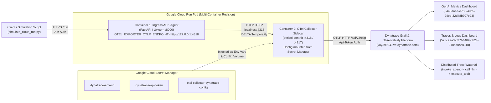
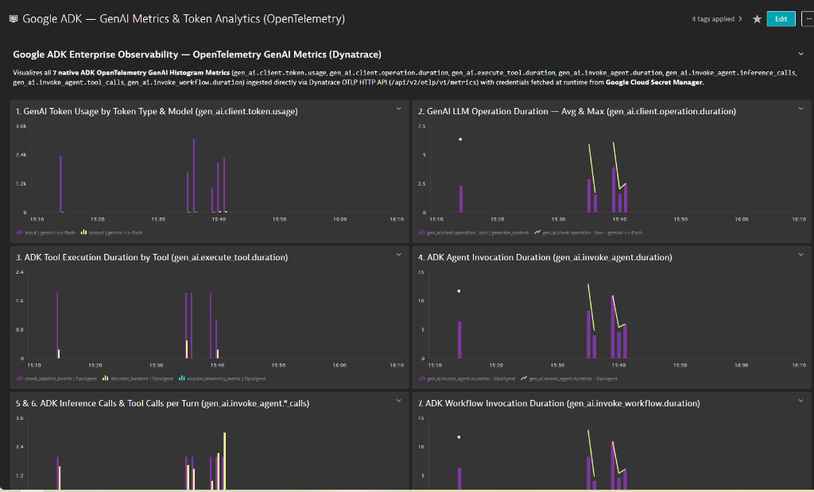
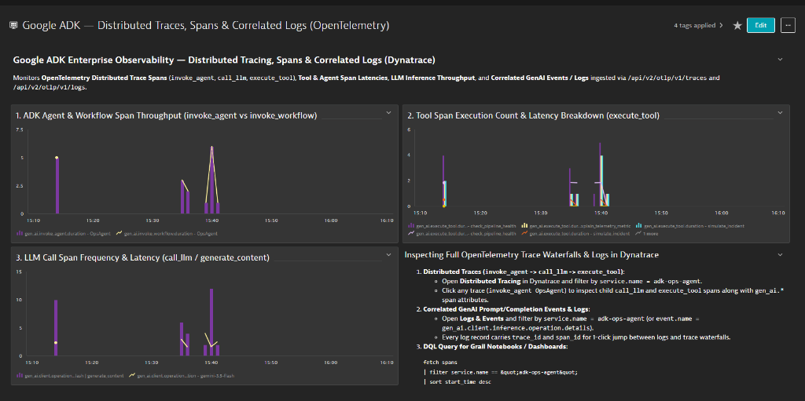
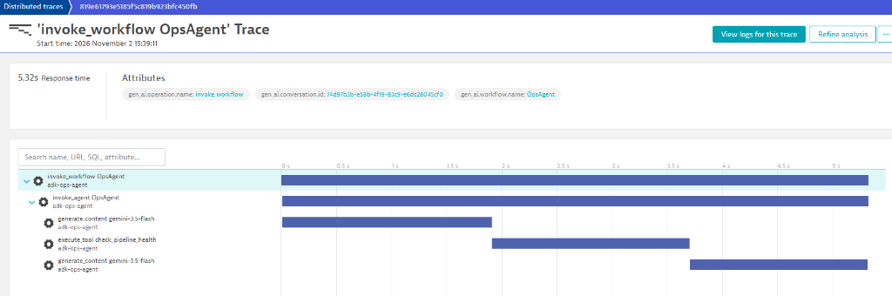

# Option 2: Deploying `OpsAgent` to Google Cloud Run with OpenTelemetry Collector Sidecar

This guide details running Google ADK `OpsAgent` on **Google Cloud Run** using a **Multi-Container (Sidecar)** pattern. Telemetry (all 7 OpenTelemetry GenAI histogram metrics, distributed trace waterfalls, and correlated logs) is collected over `localhost:4318` by an **OpenTelemetry Collector Contrib sidecar** and exported directly to **Dynatrace** (`/api/v2/otlp`) with credentials fetched dynamically from **Google Cloud Secret Manager**.

---

## Architecture Overview



---

## 1. Multi-Container Components

| Container | Role | Port | Image | Purpose |
| :--- | :--- | :--- | :--- | :--- |
| **`adk-agent`** | Ingress Main Container | `8000` | `us-central1-docker.pkg.dev/adk-enterprise-observability/adk-agents/adk-ops-agent:latest` | Hosts the ADK FastAPI server running `OpsAgent` (backed by Vertex AI Gemini `gemini-3.5-flash`). Emits traces and metrics to `127.0.0.1:4318`. |
| **`otel-collector`** | Sidecar Container | `4318` (HTTP), `4317` (gRPC) | `us-central1-docker.pkg.dev/adk-enterprise-observability/adk-agents/otel-collector:latest` | Receives OTLP telemetry from `adk-agent` over loopback, batches data, limits memory, and exports to `${DT_ENV_URL}/api/v2/otlp` with `Api-Token ${DT_API_TOKEN}`. |

---

## 2. OpenTelemetry Collector Configuration (`deploy/cloud_run/otel-collector-dynatrace.yaml`)

```yaml
receivers:
  otlp:
    protocols:
      grpc:
        endpoint: 0.0.0.0:4317
      http:
        endpoint: 0.0.0.0:4318

processors:
  memory_limiter:
    check_interval: 1s
    limit_percentage: 75
    spike_limit_percentage: 15

  batch:
    send_batch_max_size: 256
    send_batch_size: 64
    timeout: 1s

exporters:
  otlphttp/dynatrace:
    endpoint: "${env:DT_ENV_URL}/api/v2/otlp"
    headers:
      Authorization: "Api-Token ${env:DT_API_TOKEN}"

service:
  pipelines:
    traces:
      receivers: [otlp]
      processors: [memory_limiter, batch]
      exporters: [otlphttp/dynatrace]
    metrics:
      receivers: [otlp]
      processors: [memory_limiter, batch]
      exporters: [otlphttp/dynatrace]
    logs:
      receivers: [otlp]
      processors: [memory_limiter, batch]
      exporters: [otlphttp/dynatrace]
```

---

## 3. Deployment Steps

### 3.1 Store Dynatrace Credentials in GCP Secret Manager

```bash
export PROJECT_ID="adk-enterprise-observability"
export REGION="us-central1"

# 1. Dynatrace Environment URL & API Token
gcloud secrets create dynatrace-env-url --replication-policy="automatic" --project="${PROJECT_ID}"
echo -n "https://voy39934.live.dynatrace.com" | gcloud secrets versions add dynatrace-env-url --data-file=- --project="${PROJECT_ID}"

gcloud secrets create dynatrace-api-token --replication-policy="automatic" --project="${PROJECT_ID}"
echo -n "dt0c01.<YOUR_DYNATRACE_API_TOKEN>" | gcloud secrets versions add dynatrace-api-token --data-file=- --project="${PROJECT_ID}"

# 2. Store Collector YAML Configuration
gcloud secrets create otel-collector-dynatrace-config --replication-policy="automatic" --project="${PROJECT_ID}"
gcloud secrets versions add otel-collector-dynatrace-config --data-file="deploy/cloud_run/otel-collector-dynatrace.yaml" --project="${PROJECT_ID}"

# 3. Grant Secret Accessor to Service Account
gcloud secrets add-iam-policy-binding dynatrace-env-url --member="serviceAccount:adk-agent-engine-sa@${PROJECT_ID}.iam.gserviceaccount.com" --role="roles/secretmanager.secretAccessor" --project="${PROJECT_ID}"
gcloud secrets add-iam-policy-binding dynatrace-api-token --member="serviceAccount:adk-agent-engine-sa@${PROJECT_ID}.iam.gserviceaccount.com" --role="roles/secretmanager.secretAccessor" --project="${PROJECT_ID}"
gcloud secrets add-iam-policy-binding otel-collector-dynatrace-config --member="serviceAccount:adk-agent-engine-sa@${PROJECT_ID}.iam.gserviceaccount.com" --role="roles/secretmanager.secretAccessor" --project="${PROJECT_ID}"
```

### 3.2 Build Container Images with Cloud Build (No Local Docker Required)

```bash
# 1. Build & Push ADK Agent image
gcloud builds submit --config=deploy/cloud_run/cloudbuild.yaml --project="${PROJECT_ID}"

# 2. Mirror OpenTelemetry Collector Contrib image to Artifact Registry
gcloud builds submit --config=deploy/cloud_run/cloudbuild-collector.yaml --project="${PROJECT_ID}"
```

### 3.3 Deploy Multi-Container Service via `deploy/cloud_run/service.yaml`

```bash
gcloud run services replace deploy/cloud_run/service.yaml \
  --region="${REGION}" \
  --project="${PROJECT_ID}"
```

---

## 4. Traffic Simulation (`simulate_cloud_run.py`)

Run the automated SRE diagnostic suite against the deployed Cloud Run agent:

```bash
py -3.13 deploy/cloud_run/simulate_cloud_run.py
```

The script:
1. Obtains a Google Cloud IAM identity token (`gcloud auth print-identity-token`).
2. Creates an ADK session (`POST /apps/ops_agent/users/cloudrun-dynatrace-sim/sessions`).
3. Sends 5 realistic multi-tool SRE queries:
   - Pipeline health checks (`check_pipeline_health`)
   - Latency incident simulations (`simulate_incident`)
   - Service health evaluations
   - Runbook searches
   - Tool error diagnostics
4. Generates spans and metric data points delivered over `127.0.0.1:4318` to the sidecar and forwarded to Dynatrace.

---

## 5. Live Dynatrace Observability Snapshots (`voy39934`)

### 5.1 Google ADK — GenAI Metrics & Token Analytics
Visualizes all 7 OpenTelemetry GenAI histogram metrics (`gen_ai.client.token.usage`, `gen_ai.client.operation.duration`, `gen_ai.execute_tool.duration`, `gen_ai.invoke_agent.duration`, `gen_ai.invoke_agent.inference_calls`, `gen_ai.invoke_agent.tool_calls`, `gen_ai.invoke_workflow.duration`) emitted with `DELTA` temporality:



### 5.2 Google ADK — Distributed Traces, Spans & Correlated Logs
Monitors agent invocation throughput, tool execution latencies, LLM inference count, and correlated prompt/completion log records:



### 5.3 Distributed Trace Waterfall (`invoke_workflow` → `invoke_agent` → `generate_content` → `execute_tool`)
End-to-end trace waterfall showing complete parent-child span hierarchy for an agent turn:



---

## 6. Resource Teardown (Zero Ongoing Charges)

To delete the Cloud Run service and stop all telemetry:

```bash
gcloud run services delete adk-ops-agent \
  --region="us-central1" \
  --project="adk-enterprise-observability" \
  --quiet
```
