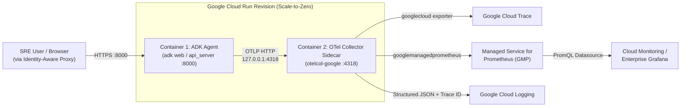

# Option 2: Deploying `OpsAgent` to Google Cloud Run with OpenTelemetry Collector Sidecar

This architecture mirrors our local zero-Docker setup on **Google Cloud Run** using Cloud Run's **Multi-Container (Sidecar)** feature:
- **Container 1 (Ingress `:8000`)**: Runs the Google ADK `OpsAgent` FastAPI / ADK Web UI server. It keeps `OTEL_EXPORTER_OTLP_ENDPOINT=http://127.0.0.1:4318` unchanged.
- **Container 2 (Sidecar `:4318`)**: Runs the **Google-Built OpenTelemetry Collector (`otelcol-google`)** inside the same Cloud Run instance. It receives OTLP traces, metrics, and logs over `localhost`, scrubs sensitive PII from prompts, and exports directly to **Google Cloud Trace**, **Google Cloud Managed Service for Prometheus (GMP)**, and **Google Cloud Logging**.

---

## Architecture Overview



---

## 1. Required GCP APIs to Enable

Run the following `gcloud` commands to enable all APIs required for Cloud Run, Artifact Registry, Vertex AI, and the GCP Observability suite:

```bash
export PROJECT_ID="your-gcp-project-id"
export REGION="us-central1"
export SERVICE_NAME="adk-ops-agent"
export REPO_NAME="adk-agents"

gcloud config set project "${PROJECT_ID}"

gcloud services enable \
  run.googleapis.com \
  artifactregistry.googleapis.com \
  cloudbuild.googleapis.com \
  aiplatform.googleapis.com \
  cloudtrace.googleapis.com \
  monitoring.googleapis.com \
  logging.googleapis.com \
  secretmanager.googleapis.com \
  iap.googleapis.com \
  iam.googleapis.com
```

### Why Each API is Required
| API | Service Name | Purpose |
| :--- | :--- | :--- |
| **Cloud Run Admin API** | `run.googleapis.com` | Hosts the multi-container serverless ADK Agent + OTel Collector sidecar |
| **Artifact Registry API** | `artifactregistry.googleapis.com` | Stores the built ADK Agent container image |
| **Cloud Build API** | `cloudbuild.googleapis.com` | Builds the container image in the cloud without requiring local Docker |
| **Vertex AI API** | `aiplatform.googleapis.com` | Invokes `gemini-2.5-flash` via IAM without static API keys |
| **Cloud Trace API** | `cloudtrace.googleapis.com` | Stores OpenTelemetry traces exported by the OTel sidecar |
| **Cloud Monitoring API** | `monitoring.googleapis.com` | Stores `gen_ai.*` token and latency metrics in Managed Prometheus (GMP) |
| **Cloud Logging API** | `logging.googleapis.com` | Centralizes structured agent and collector logs |
| **Identity-Aware Proxy API** | `iap.googleapis.com` | *(Optional)* Protects the ADK Web UI behind Google Workspace SSO |

---

## 2. Create Least-Privilege Service Account & IAM Bindings

Create a dedicated Service Account (`adk-ops-agent-sa`) so the Cloud Run service authenticates to Vertex AI, Cloud Trace, and Cloud Monitoring without any static keys:

```bash
export SA_NAME="adk-ops-agent-sa"
export SA_EMAIL="${SA_NAME}@${PROJECT_ID}.iam.gserviceaccount.com"

# 1. Create the Service Account
gcloud iam service-accounts create "${SA_NAME}" \
  --display-name="ADK OpsAgent Cloud Run Service Account"

# 2. Bind least-privilege roles for Vertex AI, Cloud Trace, GMP, and Cloud Logging
for ROLE in \
  roles/aiplatform.user \
  roles/cloudtrace.agent \
  roles/monitoring.metricWriter \
  roles/logging.logWriter; do
  gcloud projects add-iam-policy-binding "${PROJECT_ID}" \
    --member="serviceAccount:${SA_EMAIL}" \
    --role="${ROLE}"
done
```

---

## 3. Step-by-Step Implementation

### Step 3.1: Create the Production GCP Collector Config (`deploy/cloud_run/otel-collector-gcp.yaml`)
Unlike our local collector config (which exports to local Jaeger and Prometheus), the Cloud Run sidecar uses the **`googlecloud`** and **`googlemanagedprometheus`** exporters plus a **`redaction`** processor to scrub sensitive keys/emails from captured LLM prompts:

```yaml
receivers:
  otlp:
    protocols:
      grpc:
        endpoint: 127.0.0.1:4317
      http:
        endpoint: 127.0.0.1:4318

processors:
  memory_limiter:
    check_interval: 1s
    limit_percentage: 75
    spike_limit_percentage: 15

  # Enterprise Governance: Scrub sensitive patterns (emails, SSNs, bearer tokens) from GenAI span attributes
  redaction:
    allow_all_keys: true
    blocked_values:
      - "Bearer [A-Za-z0-9\\-\\._~\\+\\/]+=*"
      - "[a-zA-Z0-9._%+\\-]+@[a-zA-Z0-9.\\-]+\\.[a-zA-Z]{2,}"
    summary: info

  resourcedetection:
    detectors: [env, gcp]
    timeout: 2s
    override: false

  batch:
    send_batch_max_size: 512
    send_batch_size: 256
    timeout: 2s

exporters:
  # Exports spans to Google Cloud Trace
  googlecloud:
    trace:
      use_insecure: false

  # Exports gen_ai.client.token.usage & operation.duration to Google Cloud Managed Service for Prometheus (GMP)
  googlemanagedprometheus: {}

service:
  pipelines:
    traces:
      receivers: [otlp]
      processors: [memory_limiter, resourcedetection, redaction, batch]
      exporters: [googlecloud]

    metrics:
      receivers: [otlp]
      processors: [memory_limiter, resourcedetection, batch]
      exporters: [googlemanagedprometheus]
```

### Step 3.2: Create the ADK Agent `Dockerfile`
Create a lightweight Python 3.13 container that launches our OpenTelemetry instrumentation bootstrap alongside the ADK Web / API server on port `8000`:

```dockerfile
FROM python:3.13-slim

WORKDIR /app

ENV PYTHONDONTWRITEBYTECODE=1 \
    PYTHONUNBUFFERED=1 \
    PORT=8000 \
    OTEL_SERVICE_NAME="adk-ops-agent" \
    OTEL_EXPORTER_OTLP_PROTOCOL="http/protobuf" \
    OTEL_EXPORTER_OTLP_ENDPOINT="http://127.0.0.1:4318" \
    OTEL_INSTRUMENTATION_GENAI_CAPTURE_MESSAGE_CONTENT="true"

COPY pyproject.toml ./
COPY agents ./agents
COPY observability ./observability
COPY main.py ./

RUN pip install --no-cache-dir .

EXPOSE 8000

# Launch ADK Web UI + FastAPI server with our OpenTelemetry bootstrap
CMD ["python", "-c", "import sys; from observability.otel_setup import setup_opentelemetry; setup_opentelemetry(); from google.adk.cli import main; sys.argv = ['adk', 'web', '--host', '0.0.0.0', '--port', '8000', './agents']; main()"]
```

### Step 3.3: Build & Push Image to Artifact Registry (No Local Docker Required)
Use **Google Cloud Build** to build and push the container image directly in GCP:

```bash
# 1. Create Artifact Registry Docker repository
gcloud artifacts repositories create "${REPO_NAME}" \
  --repository-format=docker \
  --location="${REGION}" \
  --description="Google ADK Agent Containers"

# 2. Build and push image using Cloud Build
export IMAGE_URI="${REGION}-docker.pkg.dev/${PROJECT_ID}/${REPO_NAME}/${SERVICE_NAME}:latest"
gcloud builds submit --tag "${IMAGE_URI}" .
```

### Step 3.4: Store the Collector Config in Secret Manager
Cloud Run sidecars can mount configuration files directly from **Google Secret Manager**:

```bash
gcloud secrets create otel-collector-gcp-config \
  --replication-policy="automatic" \
  --data-file="deploy/cloud_run/otel-collector-gcp.yaml"

gcloud secrets add-iam-policy-binding otel-collector-gcp-config \
  --member="serviceAccount:${SA_EMAIL}" \
  --role="roles/secretmanager.secretAccessor"
```

### Step 3.5: Create Multi-Container Cloud Run Manifest (`deploy/cloud_run/service.yaml`)
Define the two-container Cloud Run service where `adk-agent` depends on the `otel-collector` sidecar starting first:

```yaml
apiVersion: serving.knative.dev/v1
kind: Service
metadata:
  name: adk-ops-agent
  annotations:
    run.googleapis.com/launch-stage: GA
    run.googleapis.com/ingress: all
spec:
  template:
    metadata:
      annotations:
        run.googleapis.com/execution-environment: gen2
        run.googleapis.com/cpu-throttling: "false"
        autoscaling.knative.dev/minScale: "0"
        autoscaling.knative.dev/maxScale: "5"
        # Ensure OTel Collector sidecar starts before ADK Agent container
        run.googleapis.com/container-dependencies: '{"adk-agent":["otel-collector"]}'
    spec:
      serviceAccountName: adk-ops-agent-sa@YOUR_PROJECT_ID.iam.gserviceaccount.com
      containers:
        # Container 1: Ingress ADK Agent (Port 8000)
        - name: adk-agent
          image: us-central1-docker.pkg.dev/YOUR_PROJECT_ID/adk-agents/adk-ops-agent:latest
          ports:
            - name: http1
              containerPort: 8000
          env:
            - name: GOOGLE_GENAI_USE_VERTEXAI
              value: "True"
            - name: GOOGLE_CLOUD_PROJECT
              value: "YOUR_PROJECT_ID"
            - name: GOOGLE_CLOUD_LOCATION
              value: "us-central1"
            - name: ADK_MODEL
              value: "gemini-2.5-flash"
            - name: OTEL_SERVICE_NAME
              value: "adk-ops-agent"
            - name: OTEL_EXPORTER_OTLP_ENDPOINT
              value: "http://127.0.0.1:4318"
          resources:
            limits:
              cpu: "1000m"
              memory: "1Gi"

        # Container 2: Google-Built OpenTelemetry Collector Sidecar
        - name: otel-collector
          image: us-docker.pkg.dev/cloud-ops-agents-artifacts/google-cloud-opentelemetry-collector/otelcol-google:0.114.0
          args:
            - "--config=/etc/otelcol/config.yaml"
          volumeMounts:
            - name: otel-config
              mountPath: /etc/otelcol
          resources:
            limits:
              cpu: "500m"
              memory: "512Mi"

      volumes:
        - name: otel-config
          secret:
            secretName: otel-collector-gcp-config
            items:
              - key: latest
                path: config.yaml
```

### Step 3.6: Deploy to Cloud Run
Deploy the multi-container YAML manifest:

```bash
gcloud run services replace deploy/cloud_run/service.yaml \
  --region="${REGION}" \
  --project="${PROJECT_ID}"
```

*(Alternative Quick Deploy without Sidecar: If you only want to deploy the agent with Cloud Trace using ADK's built-in CLI wrapper, you can run `adk deploy cloud_run --project=${PROJECT_ID} --region=${REGION} --with_ui --trace_to_cloud ./agents/ops_agent`)*

---

## 4. Connecting Your Existing Grafana Dashboards to GCP

One of the biggest advantages of **Option 2** is that you can reuse our exact [`grafana/dashboards/adk-genai.json`](../../grafana/dashboards/adk-genai.json) dashboard in **Google Cloud Monitoring** or **Grafana Enterprise**:
1. In **Google Cloud Monitoring → Dashboards**, click **Import Dashboard JSON** or configure a Grafana instance with the built-in **Google Cloud Monitoring / Prometheus** datasource.
2. All `gen_ai_client_token_usage` and `gen_ai_client_operation_duration` histograms exported by the `googlemanagedprometheus` exporter are immediately queryable via standard PromQL.
3. In **Google Cloud Trace**, every span (`invoke_agent OpsAgent`, `call_llm gemini-2.5-flash`, `execute_tool check_service_health`) appears with PII-redacted prompt/completion events.
