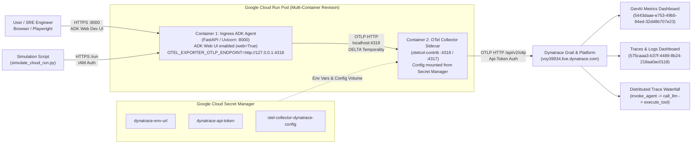
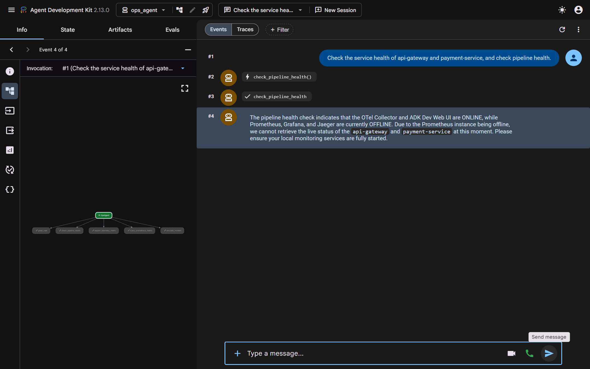

# Option 2: Deploying `OpsAgent` to Google Cloud Run with OpenTelemetry Collector Sidecar

This guide details running Google ADK `OpsAgent` on **Google Cloud Run** using a **Multi-Container (Sidecar)** architecture. Telemetry (all 7 OpenTelemetry GenAI histogram metrics, distributed trace waterfalls, and correlated logs) is collected over `localhost:4318` by an **OpenTelemetry Collector Contrib sidecar** and exported directly to **Dynatrace** (`/api/v2/otlp`) with credentials fetched dynamically from **Google Cloud Secret Manager**.

---

## Architecture Overview



---

## 1. Visual Showcase: Cloud Run Web UI & Dynatrace Observability

### 1.1 Google Cloud Run — ADK Web Dev UI & SRE Copilot
The Cloud Run deployment serves the full interactive **Google ADK Web Dev UI** on the root `/` endpoint (redirecting to `/dev-ui/?app=ops_agent`). It supports real-time streaming, interactive chat, tool inspection badges (`check_pipeline_health`, `simulate_incident`), session management, and the visual agent execution graph.



### 1.2 Dynatrace — Google ADK GenAI Metrics & Token Analytics
Visualizes all 7 OpenTelemetry GenAI histogram metrics emitted with `DELTA` temporality directly to Dynatrace:
- **`gen_ai.client.token.usage`**: Input and output token consumption grouped by model (`gemini-3.5-flash`).
- **`gen_ai.client.operation.duration`**: End-to-end LLM inference latency (Avg & Max).
- **`gen_ai.execute_tool.duration`**: Latency breakdown per SRE diagnostic tool (`check_pipeline_health`, `simulate_incident`, `explain_telemetry_metric`).
- **`gen_ai.invoke_agent.duration`**: Total duration per agent invocation turn.
- **`gen_ai.invoke_agent.inference_calls` & `tool_calls`**: Number of inference and tool executions per turn.
- **`gen_ai.invoke_workflow.duration`**: Total end-to-end workflow invocation latency.


### 1.3 Dynatrace — Distributed Traces, Spans & Correlated Logs
Monitors agent invocation throughput, tool execution latency breakdown, LLM call frequency, and correlated Grail prompt/completion logs:


### 1.4 Dynatrace — End-to-End Distributed Trace Waterfall
Shows the complete span hierarchy for an agent turn:
`invoke_workflow OpsAgent` (5.32s) → `invoke_agent OpsAgent` → `generate_content gemini-3.5-flash` → `execute_tool check_pipeline_health` → `generate_content gemini-3.5-flash`:


---

## 2. Multi-Container Components

| Container | Role | Port | Container Image | Purpose |
| :--- | :--- | :--- | :--- | :--- |
| **`adk-agent`** | Ingress Main Container | `8000` | `us-central1-docker.pkg.dev/adk-enterprise-observability/adk-agents/adk-ops-agent:latest` | Hosts the ADK FastAPI server running `OpsAgent` (backed by Vertex AI Gemini `gemini-3.5-flash`). Serves the ADK Web Dev UI on `/` and exports OTLP telemetry to `127.0.0.1:4318`. |
| **`otel-collector`** | Sidecar Container | `4318` (HTTP)<br>`4317` (gRPC) | `us-central1-docker.pkg.dev/adk-enterprise-observability/adk-agents/otel-collector:latest` | Receives OTLP telemetry from `adk-agent` over loopback, limits memory, batches data, and exports to `${DT_ENV_URL}/api/v2/otlp` with `Api-Token ${DT_API_TOKEN}`. |

---

## 3. Required GCP APIs

Run the following command to enable all required GCP APIs:

```bash
export PROJECT_ID="adk-enterprise-observability"
export REGION="us-central1"
export REPO_NAME="adk-agents"
export SERVICE_NAME="adk-ops-agent"

gcloud config set project "${PROJECT_ID}"

gcloud services enable \
  run.googleapis.com \
  artifactregistry.googleapis.com \
  cloudbuild.googleapis.com \
  secretmanager.googleapis.com \
  aiplatform.googleapis.com \
  iam.googleapis.com
```

---

## 4. Service Account & IAM Roles

Create or configure the dedicated Service Account (`adk-agent-engine-sa`) with least-privilege permissions:

```bash
SA_EMAIL="adk-agent-engine-sa@${PROJECT_ID}.iam.gserviceaccount.com"

# Grant Vertex AI user and Secret Manager secret accessor
for ROLE in \
  roles/aiplatform.user \
  roles/secretmanager.secretAccessor; do
  gcloud projects add-iam-policy-binding "${PROJECT_ID}" \
    --member="serviceAccount:${SA_EMAIL}" \
    --role="${ROLE}"
done
```

---

## 5. Step-by-Step Deployment Guide

### Step 5.1: Store Dynatrace Credentials & Collector Config in Secret Manager

```bash
# 1. Dynatrace Environment URL & API Token
gcloud secrets create dynatrace-env-url --replication-policy="automatic" --project="${PROJECT_ID}"
echo -n "https://voy39934.live.dynatrace.com" | gcloud secrets versions add dynatrace-env-url --data-file=- --project="${PROJECT_ID}"

gcloud secrets create dynatrace-api-token --replication-policy="automatic" --project="${PROJECT_ID}"
echo -n "dt0c01.<YOUR_DYNATRACE_API_TOKEN>" | gcloud secrets versions add dynatrace-api-token --data-file=- --project="${PROJECT_ID}"

# 2. Store OpenTelemetry Collector YAML Configuration
gcloud secrets create otel-collector-dynatrace-config --replication-policy="automatic" --project="${PROJECT_ID}"
gcloud secrets versions add otel-collector-dynatrace-config --data-file="deploy/cloud_run/otel-collector-dynatrace.yaml" --project="${PROJECT_ID}"

# 3. Grant Secret Accessor to Service Account
gcloud secrets add-iam-policy-binding dynatrace-env-url --member="serviceAccount:${SA_EMAIL}" --role="roles/secretmanager.secretAccessor" --project="${PROJECT_ID}"
gcloud secrets add-iam-policy-binding dynatrace-api-token --member="serviceAccount:${SA_EMAIL}" --role="roles/secretmanager.secretAccessor" --project="${PROJECT_ID}"
gcloud secrets add-iam-policy-binding otel-collector-dynatrace-config --member="serviceAccount:${SA_EMAIL}" --role="roles/secretmanager.secretAccessor" --project="${PROJECT_ID}"
```

### Step 5.2: OpenTelemetry Collector Configuration (`deploy/cloud_run/otel-collector-dynatrace.yaml`)

```yaml
receivers:
  otlp:
    protocols:
      grpc:
        endpoint: 0.0.0.0:4317
      http:
        endpoint: 0.0.0.0:4318

processors:
  memory_limiter:
    check_interval: 1s
    limit_percentage: 75
    spike_limit_percentage: 15

  batch:
    send_batch_max_size: 256
    send_batch_size: 64
    timeout: 1s

exporters:
  otlphttp/dynatrace:
    endpoint: "${env:DT_ENV_URL}/api/v2/otlp"
    headers:
      Authorization: "Api-Token ${env:DT_API_TOKEN}"

service:
  pipelines:
    traces:
      receivers: [otlp]
      processors: [memory_limiter, batch]
      exporters: [otlphttp/dynatrace]
    metrics:
      receivers: [otlp]
      processors: [memory_limiter, batch]
      exporters: [otlphttp/dynatrace]
    logs:
      receivers: [otlp]
      processors: [memory_limiter, batch]
      exporters: [otlphttp/dynatrace]
```

### Step 5.3: Server Entrypoint with Web UI Enabled (`deploy/cloud_run/server.py`)

```python
"""ADK Server entrypoint for Cloud Run container."""

import os
import uvicorn
from google.adk.cli.fast_api import get_fast_api_app

# Ensure agents package initializes OS truststore and OpenTelemetry
import agents.ops_agent

app = get_fast_api_app(
    agents_dir="agents",
    web=True,              # Serves Angular ADK Web UI on / and /dev-ui
    allow_origins=["*"],   # Enables CORS
    host="0.0.0.0",
    port=int(os.environ.get("PORT", 8000)),
)

if __name__ == "__main__":
    port = int(os.environ.get("PORT", 8000))
    uvicorn.run(app, host="0.0.0.0", port=port)
```

### Step 5.4: Build Container Images with Cloud Build (No Local Docker Required)

```bash
# 1. Create Artifact Registry repository if not already created
gcloud artifacts repositories create "${REPO_NAME}" \
  --repository-format=docker \
  --location="${REGION}" \
  --description="Google ADK Agent Containers"

# 2. Build & Push ADK Agent image
gcloud builds submit --config=deploy/cloud_run/cloudbuild.yaml --project="${PROJECT_ID}"

# 3. Mirror OpenTelemetry Collector Contrib image to Artifact Registry
gcloud builds submit --config=deploy/cloud_run/cloudbuild-collector.yaml --project="${PROJECT_ID}"
```

### Step 5.5: Multi-Container Service Manifest (`deploy/cloud_run/service.yaml`)

```yaml
apiVersion: serving.knative.dev/v1
kind: Service
metadata:
  name: adk-ops-agent
  annotations:
    run.googleapis.com/ingress: all
spec:
  template:
    metadata:
      annotations:
        run.googleapis.com/execution-environment: gen2
        run.googleapis.com/startup-cpu-boost: "true"
        autoscaling.knative.dev/minScale: "0"
        autoscaling.knative.dev/maxScale: "3"
    spec:
      serviceAccountName: adk-agent-engine-sa@adk-enterprise-observability.iam.gserviceaccount.com
      containers:
        # Container 1: Ingress Google ADK Agent (Port 8000)
        - name: adk-agent
          image: us-central1-docker.pkg.dev/adk-enterprise-observability/adk-agents/adk-ops-agent:latest
          ports:
            - name: http1
              containerPort: 8000
          env:
            - name: GOOGLE_GENAI_USE_VERTEXAI
              value: "1"
            - name: GOOGLE_CLOUD_PROJECT
              value: "adk-enterprise-observability"
            - name: GOOGLE_CLOUD_LOCATION
              value: "global"
            - name: ADK_VERTEX_LOCATION
              value: "global"
            - name: ADK_MODEL
              value: "gemini-3.5-flash"
            - name: OTEL_SERVICE_NAME
              value: "adk-ops-agent"
            - name: OTEL_EXPORTER_OTLP_PROTOCOL
              value: "http/protobuf"
            - name: OTEL_EXPORTER_OTLP_ENDPOINT
              value: "http://127.0.0.1:4318"
            - name: OTEL_EXPORTER_OTLP_METRICS_TEMPORALITY_PREFERENCE
              value: "delta"
            - name: OTEL_SEMCONV_STABILITY_OPT_IN
              value: "gen_ai_latest_experimental"
            - name: OTEL_INSTRUMENTATION_GENAI_CAPTURE_MESSAGE_CONTENT
              value: "EVENT_ONLY"
            - name: OTEL_METRIC_EXPORT_INTERVAL
              value: "3000"
          resources:
            limits:
              cpu: "1000m"
              memory: "1Gi"
          startupProbe:
            failureThreshold: 1
            periodSeconds: 240
            tcpSocket:
              port: 8000
            timeoutSeconds: 240

        # Container 2: OpenTelemetry Collector Sidecar (Receives :4318 -> Exports to Dynatrace)
        - name: otel-collector
          image: us-central1-docker.pkg.dev/adk-enterprise-observability/adk-agents/otel-collector:latest
          args:
            - "--config=/etc/otelcol/config.yaml"
          env:
            - name: DT_ENV_URL
              valueFrom:
                secretKeyRef:
                  name: dynatrace-env-url
                  key: latest
            - name: DT_API_TOKEN
              valueFrom:
                secretKeyRef:
                  name: dynatrace-api-token
                  key: latest
          volumeMounts:
            - name: otel-config
              mountPath: /etc/otelcol
          resources:
            limits:
              cpu: "500m"
              memory: "512Mi"

      volumes:
        - name: otel-config
          secret:
            secretName: otel-collector-dynatrace-config
            items:
              - key: latest
                path: config.yaml
```

### Step 5.6: Deploy Service to Cloud Run

```bash
gcloud run services replace deploy/cloud_run/service.yaml \
  --region="${REGION}" \
  --project="${PROJECT_ID}"

# Allow unauthenticated web browser access to the Web UI
gcloud run services add-iam-policy-binding adk-ops-agent \
  --region="${REGION}" \
  --project="${PROJECT_ID}" \
  --member="allUsers" \
  --role="roles/run.invoker"
```

---

## 6. Testing & Simulation

### 6.1 Automated UI Simulation & Screenshot (`capture_ui_screenshot.py`)
Executes an automated browser session against the deployed Cloud Run Web UI using Playwright:

```bash
py -3.13 deploy/cloud_run/capture_ui_screenshot.py
```

The script:
1. Opens `https://adk-ops-agent-981754278786.us-central1.run.app/dev-ui/?app=ops_agent`.
2. Handles and dismisses telemetry opt-in dialogs.
3. Submits an SRE diagnostic prompt.
4. Waits for tool invocation cards and streaming response text to render.
5. Captures a high-resolution snapshot saved to `docs/media/cloud_run_adk_web_ui.png`.

### 6.2 CLI Traffic Simulation (`simulate_cloud_run.py`)
Sends 5 realistic multi-tool SRE queries directly via Cloud Run REST API:

```bash
py -3.13 deploy/cloud_run/simulate_cloud_run.py
```

Prompts executed:
1. Pipeline health checks (`check_pipeline_health`)
2. Simulated latency incident (`simulate_incident`)
3. Service error log inspection
4. Runbook search for OTel collector pressure
5. Tool error upstream failure diagnostics

---

## 7. Resource Teardown (Zero Ongoing Charges)

> [!NOTE]
> The Cloud Run service has `minScale: 0` configured. When idle, Cloud Run scales down to **0 active container instances**, resulting in **zero idle compute charges**.

To delete the Cloud Run service completely:

```bash
gcloud run services delete adk-ops-agent \
  --region="${REGION}" \
  --project="${PROJECT_ID}" \
  --quiet
```
