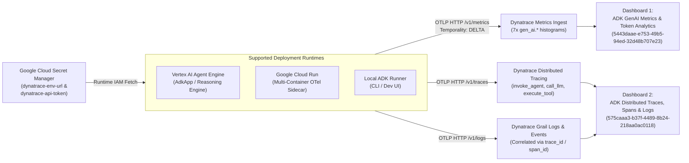
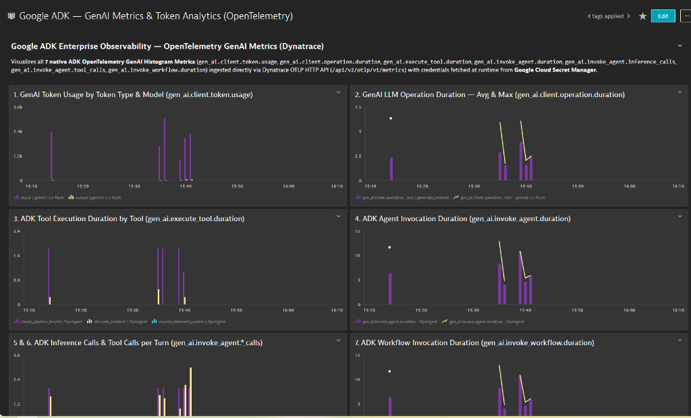
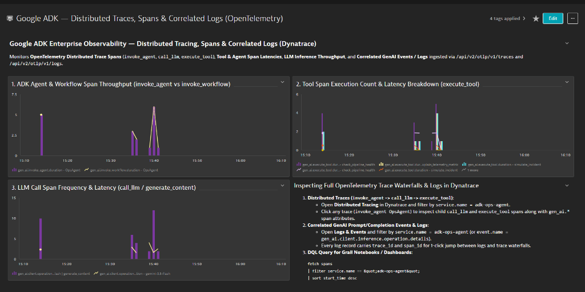
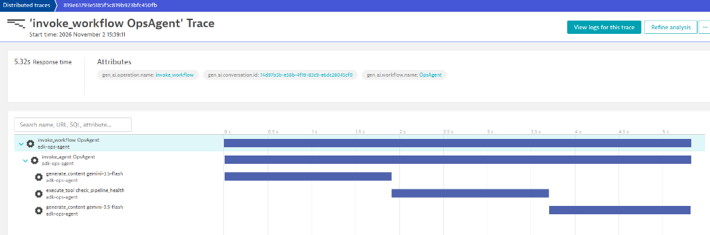

# Enterprise Observability with Dynatrace, Vertex AI Agent Engine & Cloud Run

This directory contains everything needed to export **Google ADK OpenTelemetry GenAI Metrics, Distributed Traces, and Correlated Logs** directly to **Dynatrace** (`/api/v2/otlp`) from local ADK runners, **Vertex AI Agent Engine**, and **Google Cloud Run (Multi-Container Sidecar)**, while storing your Dynatrace URL and API token securely in **Google Cloud Secret Manager** and resolving them dynamically at runtime.

---

## Architecture Overview



---

## 1. Required Dynatrace Access Token Scopes

In your Dynatrace Trial / SaaS environment (`https://voy39934.apps.dynatrace.com/ui/apps/dynatrace.classic.tokens`):
1. Click **Generate new token** (e.g., `adk-otel-ingest`).
2. Select the following scopes:
   - **`openTelemetryTrace.ingest`** *(Ingest OpenTelemetry traces)*
   - **`metrics.ingest`** *(Ingest metrics)*
   - **`logs.ingest`** *(Ingest logs)*
   - **`metrics.read`** *(Read metrics)*
   - **`DataExport`** *(Access problem and event feed, metrics, and topology)*
   - **`ReadConfig`** and **`WriteConfig`** *(Read and write configuration — used by `provision_dashboards.py` to create the dashboards automatically via REST API)*

---

## 2. Store Dynatrace URL & API Token in GCP Secret Manager

Enable Secret Manager and grant `roles/secretmanager.secretAccessor` to the Vertex AI Agent Engine service accounts:

```bash
export PROJECT_ID="adk-enterprise-observability"
PROJECT_NUMBER=$(gcloud projects describe "${PROJECT_ID}" --format="value(projectNumber)")

gcloud services enable secretmanager.googleapis.com --project="${PROJECT_ID}"

for SA in \
  "adk-agent-engine-sa@${PROJECT_ID}.iam.gserviceaccount.com" \
  "service-${PROJECT_NUMBER}@gcp-sa-aiplatform-re.iam.gserviceaccount.com"; do
  gcloud projects add-iam-policy-binding "${PROJECT_ID}" \
    --member="serviceAccount:${SA}" \
    --role="roles/secretmanager.secretAccessor"
done
```

Run [`deploy/dynatrace/setup_secrets.py`](./setup_secrets.py) to create and version the secrets (`dynatrace-env-url` and `dynatrace-api-token`) in Google Cloud Secret Manager:

```bash
py -3.13 deploy/dynatrace/setup_secrets.py \
  --project adk-enterprise-observability \
  --url "https://voy39934.live.dynatrace.com" \
  --token "dt0c01.<YOUR_TOKEN>"
```
> **Note:** If you pass a `.apps.dynatrace.com` trial URL (e.g., `https://voy39934.apps.dynatrace.com`), both [`agents/ops_agent/__init__.py`](../../agents/ops_agent/__init__.py) and [`provision_dashboards.py`](./provision_dashboards.py) automatically normalize it to `https://voy39934.live.dynatrace.com/api/v2/otlp` for OTLP and REST API calls.

---

## 3. Runtime Secret Manager Resolution (`DYNATRACE_ENABLED=true`)

When `DYNATRACE_ENABLED=true` is set at runtime (both locally and inside **Vertex AI Agent Engine** via [`deploy/agent_engine/deploy.py`](../agent_engine/deploy.py)), [`agents/ops_agent/__init__.py`](../../agents/ops_agent/__init__.py):
1. Authenticates to Google Cloud Secret Manager using Application Default Credentials (`google.auth.default()`).
2. Fetches `dynatrace-env-url` and `dynatrace-api-token` in-memory at startup (`https://secretmanager.googleapis.com/v1/projects/{project}/secrets/{secret}/versions/latest:access`).
3. Configures ADK's built-in OpenTelemetry OTLP HTTP exporters (`google.adk.telemetry.setup.maybe_set_otel_providers`):
   - `OTEL_EXPORTER_OTLP_ENDPOINT="https://voy39934.live.dynatrace.com/api/v2/otlp"`
   - `OTEL_EXPORTER_OTLP_HEADERS="Authorization=Api-Token <token>"`
   - `OTEL_EXPORTER_OTLP_PROTOCOL="http/protobuf"`
   - `OTEL_EXPORTER_OTLP_METRICS_TEMPORALITY_PREFERENCE="delta"` *(Required by Dynatrace OTLP metrics ingest; configured after `get_gcp_exporters()` so GCP Managed Service for Prometheus retains `CUMULATIVE` temporality while Dynatrace receives `DELTA` temporality simultaneously)*

---

## 4. Separate Dynatrace Dashboards (Metrics vs. Traces & Logs)

The [`deploy/dynatrace/dashboards/`](./dashboards/) folder provides two separate dashboards in both **Dynatrace Configuration API v1 format** (for automated provisioning via `provision_dashboards.py`) and **Dynatrace Grail Dashboards App format** (for 1-click UI import in `*.apps.dynatrace.com`):

| Dashboard | Live Dynatrace URL (`voy39934`) | API Provisioning JSON (`/api/config/v1/dashboards`) | Grail Dashboards App JSON (`*.apps.dynatrace.com`) | Panels Included |
| :--- | :--- | :--- | :--- | :--- |
| **1. ADK GenAI Metrics & Token Analytics** | [Open Dashboard `5443daae-e753-49b5-94ed-32d48b707e23`](https://voy39934.apps.dynatrace.com/ui/apps/dynatrace.classic.dashboards/#dashboard;id=5443daae-e753-49b5-94ed-32d48b707e23) | [`adk-genai-metrics-dynatrace-dashboard.json`](./dashboards/adk-genai-metrics-dynatrace-dashboard.json) | [`grail-adk-genai-metrics-dashboard.json`](./dashboards/grail-adk-genai-metrics-dashboard.json) | All **7 native `gen_ai.*` metrics**: `gen_ai.client.token.usage`, `gen_ai.client.operation.duration`, `gen_ai.execute_tool.duration`, `gen_ai.invoke_agent.duration`, `gen_ai.invoke_agent.inference_calls`, `gen_ai.invoke_agent.tool_calls`, `gen_ai.invoke_workflow.duration` |
| **2. ADK Distributed Traces, Spans & Logs** | [Open Dashboard `575caaa3-b37f-4489-8b24-218aa0ac0118`](https://voy39934.apps.dynatrace.com/ui/apps/dynatrace.classic.dashboards/#dashboard;id=575caaa3-b37f-4489-8b24-218aa0ac0118) | [`adk-traces-logs-dynatrace-dashboard.json`](./dashboards/adk-traces-logs-dynatrace-dashboard.json) | [`grail-adk-traces-logs-dashboard.json`](./dashboards/grail-adk-traces-logs-dashboard.json) | Agent & Workflow Span Volume (`invoke_agent`, `invoke_workflow`), Tool Execution Count & Max Latency (`execute_tool`), LLM Call Span Frequency (`call_llm`), and Correlated Trace/Log Waterfall Table |

### Provision Both Dashboards Automatically via Secret Manager
```bash
py -3.13 deploy/dynatrace/provision_dashboards.py --project adk-enterprise-observability
```

---

## 5. Deploying to Vertex AI Agent Engine & Simulating Traffic

### 5.1 Deploy `OpsAgent` to Vertex AI Agent Engine with Dynatrace Enabled
```bash
py -3.13 deploy/agent_engine/deploy.py --skip-smoke-test
```

### 5.2 Query the Deployed Vertex AI Agent Engine
```bash
py -3.13 deploy/agent_engine/query_remote.py \
  --prompt "Check the service health of api-gateway and payment-service, simulate a latency incident on auth-service, and check pipeline health."
```

### 5.3 Run Multi-Wave Telemetry Simulation (`simulate_dynatrace_telemetry.py`)
```bash
py -3.13 deploy/dynatrace/simulate_dynatrace_telemetry.py
```

---

## 6. Live Dynatrace Observability Showcase (`voy39934`)

### 6.1 Dashboard 1 — Google ADK GenAI Metrics & Token Analytics (All 7 `gen_ai.*` Metrics)
Provisioned via [`deploy/dynatrace/dashboards/adk-genai-metrics-dynatrace-dashboard.json`](./dashboards/adk-genai-metrics-dynatrace-dashboard.json):


### 6.2 Dashboard 2 — Google ADK Distributed Traces, Spans & Correlated Logs
Provisioned via [`deploy/dynatrace/dashboards/adk-traces-logs-dynatrace-dashboard.json`](./dashboards/adk-traces-logs-dynatrace-dashboard.json):


### 6.3 End-to-End Distributed Trace Waterfall (`invoke_workflow` → `invoke_agent` → `generate_content` → `execute_tool`)
Captured in Dynatrace Distributed Tracing (`service.name = adk-ops-agent`):

