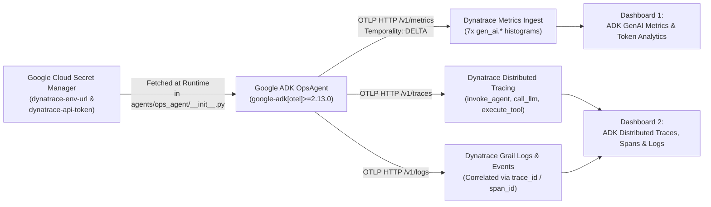

# Enterprise Observability with Dynatrace & GCP Secret Manager

This directory contains everything needed to export **Google ADK OpenTelemetry GenAI Metrics, Distributed Traces, and Correlated Logs** directly to **Dynatrace** (`/api/v2/otlp`) while storing your Dynatrace URL and API token securely in **Google Cloud Secret Manager** and resolving them dynamically at runtime.

---

## Architecture Overview



---

## 1. Required Dynatrace Access Token Scopes

In your Dynatrace Trial / SaaS environment:
1. Open **Access Tokens** (`Manage > Access tokens` or search for **Access tokens** in the Dynatrace launcher).
2. Click **Generate new token** and select the following scopes:
   - **`openTelemetryTrace.ingest`** *(Ingest OpenTelemetry traces)*
   - **`metrics.ingest`** *(Ingest metrics)*
   - **`logs.ingest`** *(Ingest logs)*
   - **`metrics.read`** *(Read metrics)*
   - **`DataExport`** *(Access problem and event feed, metrics, and topology)*
   - **`ReadConfig`** and **`WriteConfig`** *(Read and write configuration — used by `provision_dashboards.py` to create the dashboards automatically via REST API)*

---

## 2. Store Dynatrace URL & API Token in GCP Secret Manager

Run [`deploy/dynatrace/setup_secrets.py`](./setup_secrets.py) to create and version the secrets (`dynatrace-env-url` and `dynatrace-api-token`) in Google Cloud Secret Manager (`adk-enterprise-observability`):

```bash
py -3.13 deploy/dynatrace/setup_secrets.py \
  --project adk-enterprise-observability \
  --url "https://<YOUR_ENV_ID>.live.dynatrace.com" \
  --token "dt0c01.<YOUR_TOKEN>"
```
> **Note:** If you pass a `.apps.dynatrace.com` trial URL (e.g., `https://abc12345.apps.dynatrace.com`), both [`agents/ops_agent/__init__.py`](../../agents/ops_agent/__init__.py) and [`provision_dashboards.py`](./provision_dashboards.py) automatically normalize it to `https://abc12345.live.dynatrace.com/api/v2/otlp` for OTLP and REST API calls.

---

## 3. Runtime Secret Manager Resolution (`DYNATRACE_ENABLED=true`)

When `DYNATRACE_ENABLED=true` is set at runtime, [`agents/ops_agent/__init__.py`](../../agents/ops_agent/__init__.py):
1. Authenticates to Google Cloud Secret Manager using Application Default Credentials (`google.auth.default()`).
2. Fetches `dynatrace-env-url` and `dynatrace-api-token` in-memory at startup.
3. Configures ADK's built-in OpenTelemetry OTLP HTTP exporters (`google.adk.telemetry.setup.maybe_set_otel_providers`):
   - `OTEL_EXPORTER_OTLP_ENDPOINT="https://<env-id>.live.dynatrace.com/api/v2/otlp"`
   - `OTEL_EXPORTER_OTLP_HEADERS="Authorization=Api-Token <token>"`
   - `OTEL_EXPORTER_OTLP_PROTOCOL="http/protobuf"`
   - `OTEL_EXPORTER_OTLP_METRICS_TEMPORALITY_PREFERENCE="delta"` *(Required by Dynatrace OTLP metrics ingest)*

---

## 4. Separate Dynatrace Dashboards (Metrics vs. Traces & Logs)

The [`deploy/dynatrace/dashboards/`](./dashboards/) folder provides two separate dashboards in both **Dynatrace Configuration API v1 format** (for automated provisioning via `provision_dashboards.py`) and **Dynatrace Grail Dashboards App format** (for 1-click UI import in `*.apps.dynatrace.com`):

| Dashboard | API Provisioning JSON (`/api/config/v1/dashboards`) | Grail Dashboards App JSON (`*.apps.dynatrace.com`) | Panels Included |
| :--- | :--- | :--- | :--- |
| **1. ADK GenAI Metrics & Token Analytics** | [`adk-genai-metrics-dynatrace-dashboard.json`](./dashboards/adk-genai-metrics-dynatrace-dashboard.json) | [`grail-adk-genai-metrics-dashboard.json`](./dashboards/grail-adk-genai-metrics-dashboard.json) | All **7 native `gen_ai.*` metrics**: `gen_ai.client.token.usage`, `gen_ai.client.operation.duration`, `gen_ai.execute_tool.duration`, `gen_ai.invoke_agent.duration`, `gen_ai.invoke_agent.inference_calls`, `gen_ai.invoke_agent.tool_calls`, `gen_ai.invoke_workflow.duration` |
| **2. ADK Distributed Traces, Spans & Logs** | [`adk-traces-logs-dynatrace-dashboard.json`](./dashboards/adk-traces-logs-dynatrace-dashboard.json) | [`grail-adk-traces-logs-dashboard.json`](./dashboards/grail-adk-traces-logs-dashboard.json) | Agent & Workflow Span Volume (`invoke_agent`, `invoke_workflow`), Tool Execution Count & Max Latency (`execute_tool`), LLM Call Span Frequency (`call_llm`), and Correlated Trace/Log Waterfall Table |

### Provision Both Dashboards Automatically via Secret Manager
```bash
py -3.13 deploy/dynatrace/provision_dashboards.py --project adk-enterprise-observability
```
